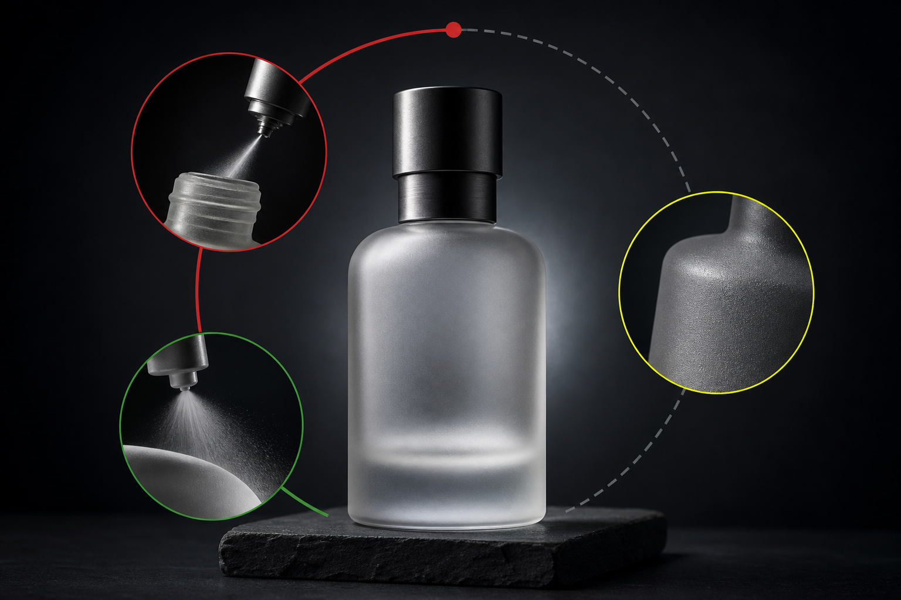

A frosted glass bottle does something a clear bottle cannot: it signals premium before anyone reads the label. That soft, diffused surface is one of the most requested finishes in cosmetics, spirits, fragrance, and pharmaceutical packaging right now. But if you're sourcing frosted glass bottles for the first time, the process behind that finish matters as much as the look. The method you choose affects durability, cost per unit, minimum order size, label adhesion, and how the bottle performs on a filling line.

This article covers how each frosting method works, what separates them in practice, and what to expect in terms of cost and planning when adding a frosted finish to your glass packaging.

---

## Why Frosted Glass Bottles Are Growing in Demand

The appeal is partly aesthetic, partly functional. A frosted surface scatters light rather than transmitting it, softening the bottle's appearance and giving it a tactile quality that clear glass simply doesn't have. For brands selling at a premium price point, that tactile difference is worth real money.

The numbers reflect the trend. In its 2025 report, futuremarketinsights.com estimated the frosted bottle market at USD 6.7 billion and projected growth at a CAGR of 4.8 percent through 2035. The dropper bottle segment — heavily driven by cosmetics and essential oil brands — shows even sharper momentum: marketintelo.com's 2026 analysis put the frosted glass dropper bottle market at USD 1.2 billion and projected it to reach USD 1.9 billion by 2034, expanding at 5.8 percent annually.

The end-use categories driving this are consistent across reports: skincare and personal care, fragrance and perfume, spirits and premium beverages, and pharmaceutical packaging where light protection matters.

---

## The Three Main Methods for Frosting Glass Bottles

There's no single way to frost a glass bottle. Three methods dominate commercial production, and each produces a different result, carries different costs, and suits different applications.

### Acid Etching

Acid etching is the original industrial method and still the benchmark for quality. The bottle is exposed to hydrofluoric acid or an ammonium bifluoride compound, which chemically attacks the silica on the glass surface and creates a uniform, fine-grained matte texture.

The result is permanent. The frosted layer isn't a coating sitting on top of the glass — it is the glass itself, restructured at a microscopic level. It won't peel, chip, or wear off in the supply chain or in a consumer's hands. The surface feels smooth despite its matte appearance, which makes it the preferred choice for fragrance bottles and high-end cosmetics where tactile quality is part of the brand experience.

The tradeoff is process complexity. Acid etching requires controlled chemical handling, waste treatment, and consistent process parameters to avoid uneven etching or surface defects. For buyers, that translates to higher per-unit costs and better economics at meaningful production volumes.

One downstream consideration worth flagging: acid-etched surfaces can be slightly more challenging for pressure-sensitive labels because the micro-texture affects adhesive contact. Your label supplier should know the finish type before specifying adhesive.

### Sandblasting

Sandblasting uses abrasive media propelled at high velocity to physically abrade the glass surface. The result is a matte texture that's slightly coarser than acid etching and more variable depending on media type, pressure, and angle.

It's well-suited for partial frosting — treating only a section of the bottle — or for creating textured patterns and gradients. Because it's a mechanical process, there are no chemical waste streams, which can simplify compliance for manufacturers with strict environmental controls.

The surface produced by sandblasting is more porous than acid etching, and that has two practical implications. First, fingerprints and oils from handling transfer more visibly onto a sandblasted surface — worth considering for retail packaging. Second, that open texture means sandblasted bottles can benefit from an anti-fingerprint topcoat applied after frosting, which seals the surface and reduces smudging without eliminating the matte look.

From a recyclability standpoint, sandblasted bottles are straightforward to recycle because no chemical coating is added to the glass.

### Spray Frosting

Spray frosting applies a frosted coating to the exterior of the glass rather than altering the glass itself. A fine mist of frosting compound is sprayed onto the bottle surface and cured, producing a matte appearance that closely mimics acid etching at lower cost.

The practical advantage is flexibility. Spray frosting works on smaller runs, can be applied selectively, and doesn't require the chemical handling infrastructure that acid etching demands. It's also the most accessible method for decorators working with standard catalog bottles rather than custom-molded shapes.

The limitation is durability. Because the frost is a surface coating rather than a structural change to the glass, it's more susceptible to abrasion during shipping, filling-line handling, and consumer use. For products that will be handled frequently or shipped without secondary packaging, spray frosting may show wear over time.

---

## Cost Breakdown by Frosting Method

Frosting adds a post-processing step to every unit, and that cost varies significantly by method.

Spray frosting is the most accessible entry point. Published 2026 data from Vella puts spray frost decoration at approximately RMB 0.5 to 1.1 per bottle, which is roughly USD 0.07 to 0.15 at current exchange rates. That figure covers the decoration step only and doesn't include the base bottle cost, packaging, or shipping.

Vella's 2026 data also notes that spray frosting typically requires a decorating minimum of 2,000 to 5,000 pieces per shape — a threshold that matters for brands launching a new SKU or testing a packaging concept before committing to a larger run.

Acid etching and sandblasting carry higher per-unit decoration costs because of process complexity, equipment requirements, and in the case of acid etching, chemical handling and waste treatment. Exact figures vary by supplier, bottle geometry, and volume, so the most reliable approach is to request itemized quotes that separate the base bottle cost from the decoration cost. That breakdown lets you compare methods honestly and understand where volume discounts apply.

A few cost factors buyers often overlook:

**Rework risk**: Acid etching defects are permanent. A bottle with uneven etching cannot be corrected. Spray frosting defects can sometimes be stripped and recoated, which reduces waste but adds lead time.

**Label compatibility**: If your design includes a pressure-sensitive label over the frosted area, you may need a higher-tack adhesive, which adds label cost.

**Anti-fingerprint topcoat**: For sandblasted bottles going to retail, a topcoat adds a step and a cost — but it can meaningfully improve shelf presentation by reducing visible fingerprints.

**Total landed cost**: A spray-frosted bottle may have a lower decoration cost per unit but a higher defect rate in transit if the coating isn't adequately protected. Factor secondary packaging into your total cost model.

---

## Quality Checks Buyers Should Request

Frosting quality isn't self-evident from a photograph. When evaluating a supplier or approving a production sample, ask for documentation on the following:

**Surface uniformity**: The frosted area should be consistent in texture and opacity across the entire treated surface. Blotchy or streaky frosting is a process control failure.

**Adhesion test for coatings**: For spray-frosted bottles, a cross-hatch adhesion test confirms that the coating bonds properly to the glass and won't flake under normal handling.

**Abrasion resistance**: Request a rub test result that simulates filling-line conveyor contact. This is especially relevant for spray-frosted bottles.

**Chemical resistance**: If your product formula will contact the bottle's interior, confirm that the frosting process doesn't affect the interior surface. Acid etching is typically applied externally, but process controls should be documented.

**Batch consistency**: Ask for gloss and color measurements across multiple bottles from the same production run. Frosting should be consistent from bottle to bottle, not just within a single unit.

---

## How Frosting Affects Downstream Operations

Brands sometimes approve a frosted finish without consulting their filling and packaging teams first. That can create real problems.

On a filling line, frosted bottles behave differently from clear glass. The surface friction of a sandblasted or spray-frosted bottle is higher, which can affect conveyor speed settings and increase the risk of bottles tipping or jamming on high-speed lines. Communicate the finish type to your contract manufacturer or filling partner before finalizing the packaging spec.

For labeling, pressure-sensitive labels applied over frosted surfaces need adequate adhesive tack. Run adhesion tests on production-representative samples — not just on smooth glass — before committing to a label spec.

For retail display, fingerprint visibility is worth a practical test. Hold a sandblasted bottle for thirty seconds, set it down, and observe. If the result doesn't work for your retail environment, an anti-fingerprint topcoat is worth the added step.

---

## Sourcing Frosted Glass Bottles: What to Look For in a Supplier

A frosted finish is only as good as the base bottle and the process controls behind it. When evaluating suppliers, look for manufacturers who handle frosting as an integrated post-processing step rather than outsourcing it to a third party. Integrated production gives you a single point of accountability for quality across both the bottle and the finish.

[Hwa Hsia Glass](https://hwahsiaglass.com), founded in 1925 and Taiwan's largest household glass bottle manufacturer, provides end-to-end custom solutions covering design, production, post-processing, and complete finished packaging. That integrated model means frosting, labeling, and packaging decisions are coordinated from the start rather than managed across multiple vendors.

The catalog spans food jars, beverage and wine bottles, pharmaceutical bottles, perfume and cosmetics bottles, and glass cups, with a handmade glass line for premium applications where artisan surface quality matters. For buyers sourcing frosted bottles for cosmetics or fragrance, the perfume and cosmetics range is a practical starting point for standard shapes, and custom commissions are available for proprietary designs.

Certifications and quality performance metrics are documented at hwahsiaglass.com/en/certifications — useful for procurement teams that need supplier quality documentation for ESG reporting or internal sourcing audits.

---

## Frequently Asked Questions

**What is the most durable frosting method for glass bottles?**
Acid etching. Because it permanently alters the glass surface rather than applying a coating, the frosted texture won't peel or wear off under normal handling, shipping, or consumer use.

**Can frosted glass bottles be recycled?**
Yes. Acid-etched and sandblasted bottles are fully recyclable because no foreign material is added to the glass. Spray-frosted bottles carry a surface coating, but they're still accepted in standard glass recycling streams in most markets. If recyclability is a specific ESG requirement, confirm the coating composition with your supplier.

**Does frosting affect how a label adheres to the bottle?**
It can. Frosted surfaces — particularly sandblasted ones — have a micro-texture that reduces the contact area for pressure-sensitive adhesive labels. Specify the frosting method to your label supplier so they can recommend the appropriate adhesive, and run adhesion tests on production samples before finalizing your label spec.

**What minimum order quantities apply to frosted glass bottles?**
MOQ varies by supplier and frosting method. Published 2026 data from Vella notes that spray frosting typically requires a decorating minimum of 2,000 to 5,000 pieces per shape. Acid etching and sandblasting minimums depend on the manufacturer's process setup. Contact your supplier directly for current figures.

**How does spray frosting compare to acid etching in appearance?**
High-quality spray frosting closely mimics the look of acid etching to the eye. The main practical differences are durability and surface feel. Acid-etched surfaces tend to feel smoother despite their matte appearance, while spray-frosted surfaces may feel slightly different depending on the coating formulation.

**What should I ask a supplier when requesting a frosted bottle sample?**
Ask for a production-representative sample, not a hand-finished prototype. Request documentation on the frosting method used, adhesion test results for coated finishes, and batch consistency data. If you plan to apply labels, test adhesion on the actual sample before approving.

**Is frosting available on custom bottle shapes, or only standard catalog shapes?**
Both. Standard catalog bottles can be frosted as a post-processing step, and custom-molded bottles can receive frosting as well — though tooling cost for a custom mold is a separate consideration. Suppliers who handle both molding and post-processing in-house are better positioned to coordinate the two.

---

## Making the Right Finish Decision

The frosting method you choose will follow your product through every stage of its life: production, shipping, retail display, and consumer use. Acid etching, sandblasting, and spray frosting each have a legitimate place depending on your volume, budget, durability requirements, and downstream operations.

Start by defining what matters most for your specific application. Then request itemized quotes that separate the base bottle cost from the decoration cost, ask for adhesion and abrasion test data, and test production-representative samples on your actual filling and labeling equipment before finalizing the spec. That sequence will save you from expensive surprises after tooling and production have already begun.

For brands sourcing frosted glass bottles with integrated post-processing and global export capability, explore the catalog and submit an inquiry at [Hwa Hsia Glass](https://hwahsiaglass.com).
