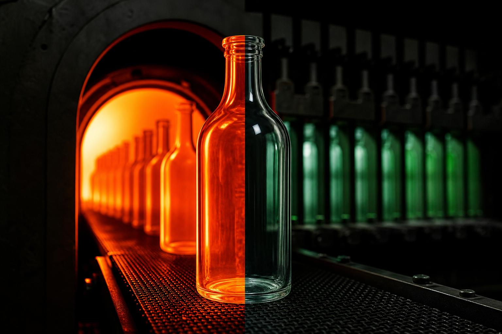

Glass annealing rarely comes up in sourcing conversations — but it determines whether a finished bottle survives shipping, filling lines, and years of use, or cracks under ordinary stress. If you buy glass packaging at any volume, understanding what annealing does (and what happens when it's skipped or rushed) gives you a sharper lens for evaluating supplier quality.

This article covers the science behind annealing, how the process works in a production environment, and what it means for your packaging decisions.

## What Glass Annealing Actually Is

When molten glass is shaped into a bottle or jar, the outer surface cools faster than the interior. That temperature difference creates internal stress within the glass wall. Left unaddressed, those stresses make the container fragile in ways that aren't always visible — a bottle can look perfect and still shatter from a modest impact or a sudden temperature change.

Annealing is the controlled process of reheating finished containers to a specific temperature, then cooling them slowly and uniformly. The goal is to relieve that internal stress by giving the glass molecules time to settle into a stable arrangement before the temperature drops further.

The word comes from the Old English term for "to burn," but the practical meaning is almost the opposite: it's about managing heat carefully, not applying it aggressively.

## How the Annealing Process Works

### The Lehr: The Machine at the Center of Annealing

In industrial glass production, annealing takes place inside a long tunnel oven called a lehr (sometimes spelled "leer"). Freshly formed bottles travel through it on a conveyor belt, passing through precisely controlled temperature zones.

The process follows three broad stages:

**Reheating.** Bottles enter the lehr and are brought back up to the annealing point — a temperature range at which the glass is still solid but the molecular structure can relax. For standard soda-lime glass (the most common composition for food, beverage, and cosmetics containers), this typically falls between 500 and 600 degrees Celsius, though the exact figure depends on the glass composition.

**Soaking.** The bottles are held at the annealing temperature long enough for stress to equalize throughout the wall thickness. Thicker glass requires a longer soak because heat takes more time to reach the center.

**Controlled cooling.** This is the defining step. Temperature is reduced gradually — degrees per minute, not per second — through the strain point and down toward room temperature. Once the glass drops below the strain point, faster cooling is acceptable. Above it, any sudden drop reintroduces the very stress the process was designed to remove.

Total time inside the lehr can range from a few minutes for thin-walled containers to considerably longer for heavy or complex shapes.

### Why "Slow" Is the Operative Word

Speed is the enemy of annealing quality. If the cooling rate is too fast at the wrong temperature, new stress gradients form before the glass has stabilized. The result is a container with residual stress that behaves unpredictably — it may pass visual inspection and even basic impact testing, then fail during pasteurization, carbonated filling, or cold-chain transport.

Slow, uniform cooling gives the glass structure time to reach equilibrium. That equilibrium is what separates a bottle that performs reliably across its entire service life from one that doesn't.

## What Happens to Glass That Isn't Properly Annealed

Poorly annealed glass carries internal stress that shows up as real-world problems:

- **Spontaneous fracture.** A bottle under residual stress can crack without any external impact, particularly when exposed to temperature changes during filling or storage.
- **Reduced impact resistance.** Stress concentrations at the shoulder, heel, or seam make those areas more vulnerable to breakage during handling and transit.
- **Inconsistent performance.** Two bottles from the same production run may behave differently if annealing was uneven — one survives the filling line, another doesn't.
- **Failure under internal pressure.** For carbonated beverages or pressurized pharmaceutical containers, residual stress reduces the safety margin against internal pressure — a serious quality and liability concern.

For brands, these failures translate directly into product loss, customer complaints, and potential safety issues. For procurement teams, they're a supplier quality problem that surfaces after the order has already shipped.

## Annealing Across Different Glass Container Types

Annealing requirements aren't identical for every container. Several factors shift the parameters.

### Wall Thickness and Shape Complexity

A heavy-walled spirits bottle and a thin-walled pharmaceutical vial both require annealing, but the process parameters differ significantly. Thick glass holds heat longer and needs a slower, more carefully staged cooling curve. Complex shapes — embossed surfaces, sharp shoulder angles, thick bases with thin walls — create uneven heat distribution that demands tighter lehr control.

### Glass Composition

Standard soda-lime glass has well-established annealing parameters. Borosilicate glass, used in pharmaceutical and laboratory applications, has different thermal properties and its own annealing range. A manufacturer working across both pharmaceutical and consumer categories needs process knowledge for both compositions.

### Container Size

Larger containers have more mass and greater wall-to-interior temperature differentials. The lehr speed and temperature profile must account for this. A one-liter wine bottle and a 30ml perfume bottle are not annealed on the same schedule.

## How Annealing Connects to Quality Certification

Annealing quality isn't something a buyer can verify by looking at a finished bottle. It requires process control documentation, equipment calibration records, and testing — typically polariscopic stress testing, which uses polarized light to make internal stress patterns visible.

This is one reason why quality certifications and published performance metrics matter when evaluating a glass packaging supplier. Documented process controls are the only reliable evidence that annealing is being done correctly and consistently across production runs.

## Why This Matters When Sourcing Glass Packaging

Annealing quality is a meaningful differentiator between suppliers — even though it's invisible in the finished product. A few questions worth raising with any supplier:

- What lehr equipment do you use, and how is it calibrated?
- What is your process for stress testing finished containers?
- How do you adjust annealing parameters for different wall thicknesses or glass compositions?
- Can you provide quality documentation covering your annealing process controls?

Suppliers who have been manufacturing glass for decades tend to have well-established lehr protocols because they've seen what happens when those protocols slip. That institutional knowledge isn't something a newer operation can replicate quickly.

Hwa Hsia Glass has been manufacturing glass containers in Taiwan since 1925 — over 100 years of continuous production across food jars, beverage and wine bottles, pharmaceutical bottles, and perfume and cosmetics containers. That depth of manufacturing history means annealing protocols have been refined across generations of production equipment and product types, not just written down on paper.

## Annealing and Premium or Handmade Glass

For handmade glass, annealing takes on additional importance. Handmade production introduces more variability in wall thickness and shape than machine-formed glass. Individual pieces cool at slightly different rates depending on the craftsperson's technique and the ambient environment.

Annealing in a controlled lehr is what standardizes the outcome. Without it, even beautifully formed handmade pieces would be structurally unreliable. For premium spirits brands, luxury cosmetics, or artisan food products that specify handmade glass for its visual character, the annealing step is what makes that choice commercially viable at any scale.

## The Bigger Picture: Annealing as a Proxy for Manufacturing Discipline

Annealing doesn't appear on packaging artwork or in marketing copy. But it's a reliable indicator of a glass manufacturer's overall production discipline.

A supplier who controls annealing carefully — with calibrated equipment, documented parameters, and consistent testing — is almost certainly applying the same rigor to forming, inspection, and finishing. A supplier who treats annealing as a box to check is likely cutting corners elsewhere too.

For buyers who can't visit a factory before placing an order, understanding what annealing is and asking about it directly is a practical way to separate manufacturers who take process quality seriously from those who don't.

---

## Frequently Asked Questions

**What is glass annealing?**
Glass annealing is a controlled heating and slow-cooling process applied to freshly formed glass containers. Its purpose is to relieve internal stress that builds up when the outer surface of a bottle cools faster than the interior during forming. Without annealing, that stress makes glass fragile and prone to spontaneous fracture or failure under normal use conditions.

**What is a lehr in glass manufacturing?**
A lehr is a long tunnel oven used in industrial glass production to anneal finished containers. Bottles travel through it on a conveyor belt, passing through temperature zones that reheat the glass to its annealing point and then cool it gradually at a controlled rate. The lehr is the primary piece of equipment responsible for stress relief in commercial glass bottle production.

**How do I know if a glass bottle has been properly annealed?**
You can't tell by looking at a finished bottle. Residual stress is invisible under normal light. Manufacturers use polariscopic stress testing — which uses polarized light to reveal internal stress patterns — to verify annealing quality. When evaluating a supplier, ask for quality documentation and certifications that cover their annealing process controls.

**Does annealing affect the strength of a glass bottle?**
Yes, directly. Proper annealing removes the internal stress that makes glass vulnerable to impact, thermal shock, and internal pressure. A well-annealed bottle is significantly more resistant to breakage during shipping, filling, and use than one that has been cooled too quickly or unevenly. For carbonated beverages or pressurized pharmaceutical containers, the difference in safety margin is especially significant.

**Is the annealing process different for pharmaceutical glass versus food and beverage glass?**
The core principle is the same, but the parameters differ. Pharmaceutical glass often uses borosilicate compositions with different thermal properties than standard soda-lime glass, which shifts the annealing temperature range. Wall thickness, container size, and shape complexity also affect the lehr speed and temperature profile. A manufacturer working across both pharmaceutical and consumer categories needs process knowledge for both glass types.

**Why does slow cooling matter more than fast cooling during annealing?**
Rapid cooling above the glass strain point reintroduces stress gradients before the molecular structure has stabilized. The whole purpose of annealing is to give the glass time to reach thermal equilibrium at a temperature where the structure can relax. Once the glass cools below the strain point, faster cooling is acceptable — but above it, speed defeats the process entirely.

**What should procurement teams ask a glass supplier about annealing?**
Ask about their lehr equipment and calibration schedule, how they adjust annealing parameters for different wall thicknesses and glass compositions, what stress testing they perform on finished containers, and whether they can provide process control documentation. Suppliers with long manufacturing histories and formal quality certification programs are more likely to have well-documented, consistently applied annealing protocols.

---

## Make Annealing Part of Your Supplier Evaluation

The next time you're reviewing a glass packaging supplier, add annealing to your quality checklist. It's a small question that reveals a lot about how seriously a manufacturer takes process discipline.

Hwa Hsia Glass has been producing glass containers in Taiwan since 1925, serving food, beverage, pharmaceutical, and cosmetics brands with end-to-end service from design through global shipping. Quality certifications and performance metrics are documented and publicly accessible. To explore the product range or start a sourcing conversation, visit [hwahsiaglass.com](https://hwahsiaglass.com).
