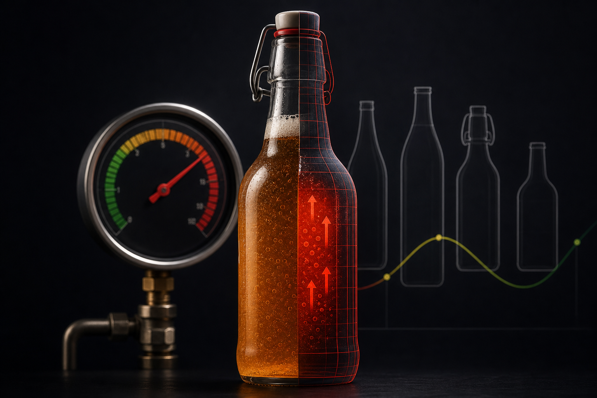

Choosing the right glass bottle for kombucha is a safety decision before it is a branding one. Kombucha is a live, carbonated beverage that keeps producing CO2 after sealing. Put that pressure into the wrong bottle and you are looking at cracked seams, blown caps, or worse. This guide covers what the pressure numbers actually mean, which bottle specs matter, and how to source reliably at scale.

## Why Glass Dominates Kombucha Packaging

Glass holds a strong position in kombucha packaging because of what it does not do. It does not absorb flavors, does not leach chemicals into an acidic liquid, and does not deform under carbonation pressure the way thin plastic can.

According to a 2026 analysis cited on blog.factmr.com, glass bottles account for around 40% of kombucha packaging share. A separate 2026 report from snsinsider.com found that bottles as a category led the entire kombucha packaging segment with a 54.60% share in 2025, confirming that rigid, resealable formats are what most producers and consumers prefer.

Cans are growing — snsinsider.com's 2026 data puts their CAGR at 10.80% through 2035 — but glass remains the format of choice for craft and premium brands where appearance, taste neutrality, and reusability matter.

## How Much Pressure Does Kombucha Actually Generate?

This is where most buyers underestimate the engineering requirement. Kombucha is not a still beverage with a little fizz. Secondary fermentation inside a sealed bottle can push carbonation well beyond what most general-purpose glass containers are designed to handle.

Alibaba's 2026 buyer guide states that kombucha carbonation can build pressure between 30 and 60 PSI during bottling. The same guide notes that most household glass containers are rated for only 15 to 25 PSI — a significant gap that explains why standard mason jars and repurposed sauce bottles are not safe choices for carbonated kombucha.

The Bottle Depot's 2026 guidance recommends bottles capable of handling at least 40 to 60 PSI for bottle-conditioning applications. Glassypack's 2026 recommendations go further, specifying a minimum burst pressure rating of 6 bar (roughly 87 PSI) — a figure that provides meaningful headroom above the typical operating range.

The practical takeaway: never assume a bottle rated for still beverages is rated for carbonated ones. Ask for the burst pressure specification, not just the wall thickness.

## Pressure Testing: What to Ask Your Supplier

Knowing the number is not enough. You need documentation that the bottle has actually been tested to that number. When evaluating a glass supplier, request the following before placing an order:

**Burst pressure test reports.** These confirm the pressure at which a sample batch failed. A reputable manufacturer will have batch-level data, not just a catalog spec.

**Internal pressure test certificates.** Some markets require these as part of food-contact compliance. Even where they are not mandatory, they signal that the supplier takes structural integrity seriously.

**Wall thickness measurements.** Uniform wall thickness is a proxy for consistent pressure distribution. Ask for the minimum and maximum measurements across the bottle body, shoulder, and heel — the three points where stress concentrates most.

**Mold generation records.** Glass molds wear over time, and older molds produce thinner, less consistent walls. Knowing the mold cycle count helps you assess whether a low price reflects a mold that is overdue for replacement.

If a supplier cannot provide these documents, treat that as a red flag regardless of price.

## Bottle Geometry and Internal Pressure Distribution

Bottle shape affects how pressure is distributed internally, and that has direct safety implications for carbonated kombucha.

Cylindrical bodies with rounded shoulders handle pressure more evenly than bottles with sharp angles or flat panels. Pressure concentrates at stress points — sharp corners, embossed logos, and thin-walled panels are all areas where a bottle is more likely to fail under sustained carbonation. For kombucha, a straight-sided or slightly tapered cylinder with a rounded shoulder is the safest geometry. Tall, narrow bottles with pronounced necks also perform well because the small headspace volume limits the total pressure load on the walls.

Avoid heavily embossed designs for your primary production run unless you have confirmed that the embossing does not reduce wall thickness below spec. Surface texture is fine; deep relief that cuts into the glass wall is not.

## Sizes, Closures, and UV Protection

### Bottle Sizes

Glassypack's 2026 guidance recommends 330 ml and 473 ml as the most practical sizes for kombucha. These align with standard serving sizes and are widely available as stock items, which reduces lead times and minimum order quantities.

Larger formats — 750 ml and 1 L — are common for retail sharing bottles and foodservice, but they require proportionally thicker walls to maintain the same pressure safety margin. If you move to larger sizes, confirm the pressure rating separately. Do not assume it scales linearly from a smaller bottle spec.

### Closures

The closure is as important as the bottle. Three formats dominate kombucha:

**Swing-top (Grolsch-style) closures** are popular for craft and home-brew markets. They create a reliable seal and are easy to open and reseal, but the rubber gasket degrades over time and needs periodic replacement. They are not well suited to high-volume production lines.

**Crown caps** are the standard for commercial kombucha production — fast to apply, inexpensive, and consistent. The bottle finish must be a standard crown finish; confirm the outer diameter with your supplier.

**Screw caps** work well for kombucha with moderate carbonation levels and offer a practical reseal advantage for larger formats. Use a tamper-evident band and specify a torque range with your capper settings to avoid under- or over-sealing.

### Clear vs. Amber Glass

UV light degrades kombucha cultures and can affect flavor over time. Amber glass blocks most UV wavelengths and is the safer choice for products stored in retail environments with fluorescent or natural light exposure.

Clear glass is widely used for kombucha, particularly when the product's color is part of the brand presentation. If you go that route, ensure your supply chain includes UV-protective secondary packaging or that shelf life is short enough that UV degradation is not a practical concern.

## Thermal Shock and Cold-Chain Handling

Kombucha is typically refrigerated after bottling to slow secondary fermentation and control carbonation. Moving glass bottles rapidly between temperatures creates thermal shock risk — the outer surface contracts or expands faster than the inner surface, introducing stress.

Borosilicate glass handles thermal shock better than soda-lime glass, but most commercial kombucha bottles are soda-lime. For soda-lime glass, avoid moving bottles directly from a hot rinse or pasteurization step into cold storage without a gradual temperature transition. A 20 to 30 degree Celsius differential is generally manageable; larger swings increase the risk of hairline fractures that may not be visible but reduce burst pressure tolerance.

If your process involves hot-fill or tunnel pasteurization, specify that requirement to your supplier explicitly. Bottles designed for hot-fill have different wall profiles than standard cold-fill bottles.

## Incoming Inspection: What to Check Before Bottles Go to the Line

Even with a reliable supplier, incoming inspection protects your production run. A basic checklist for each shipment:

**Dimensional check:** Verify neck finish diameter, overall height, and capacity against your spec sheet. Variations affect capper settings and fill volumes.

**Visual inspection:** Look for seeds (small bubbles in the glass), stones (solid inclusions), checks (surface cracks), and cord (streaks of different glass composition). Any of these can become stress points under carbonation pressure.

**Wall thickness spot check:** Use a handheld ultrasonic gauge on a sample from each pallet and flag anything below your minimum spec.

**Sealing surface inspection:** The top of the neck must be flat and chip-free. Any irregularity here will cause seal failures regardless of how good your capper is.

**Pressure test a sample batch:** If you have the equipment, pull 10 to 20 bottles per shipment and pressure-test to 1.5x your operating pressure. This is standard practice in beverage manufacturing and catches mold-wear issues before they reach your line.

## Sourcing Kombucha Glass Bottles: Practical Considerations

### Stock vs. Custom

Stock bottles are the fastest path to market. Lead times are shorter, minimum order quantities are lower, and samples are easy to request. The trade-off is that your bottle will not be unique to your brand.

Custom bottles require tooling investment and longer lead times, but they give you full control over geometry, embossing, color, and finish. For established brands with consistent volume, custom tooling typically pays back within a few production runs.

### MOQs and Supply Planning

Glass bottle MOQs vary widely depending on whether you are ordering stock or custom. For stock items, some suppliers will go as low as a few hundred units. Custom molds typically require higher minimums to justify the tooling cost.

Plan your supply chain with at least 8 to 12 weeks of buffer stock, particularly if you are importing. Glass is heavy, and ocean freight plus customs clearance can stretch total replenishment time to 10 to 16 weeks from order to warehouse.

### Working with a Manufacturer Directly

Buying directly from a glass manufacturer rather than through a distributor gives you access to technical documentation, mold customization, and post-processing options — frosting, screen printing, custom closures — all from a single source.

[Hwa Hsia Glass](https://hwahsiaglass.com), founded in 1925 in Taiwan, manufactures glass containers across food, beverage, and specialty categories, and handles custom design, production, and post-processing for global shipments. For kombucha producers sourcing at scale, working with a manufacturer that can provide pressure-test documentation and accommodate custom specifications is worth the additional planning time compared to buying through a distributor who may not have direct access to production data.

## The Market Context

The kombucha packaging market was valued at $1.8 billion in 2025, according to marketintelo.com's 2026 report, and the same source projects it will reach $3.4 billion by 2034. That growth trajectory means more producers entering the market, more competition on shelf, and more pressure — literally and commercially — on packaging decisions.

Getting your bottle specification right early, before you scale, is far cheaper than a product recall or a line stoppage caused by pressure failures at volume.

## FAQs

**What pressure rating should a kombucha glass bottle have?**
A kombucha bottle should be rated for a minimum burst pressure of 6 bar (approximately 87 PSI) according to Glassypack's 2026 recommendations. Operating pressure during bottle-conditioning can reach 40 to 60 PSI, so meaningful headroom above that range is important for safety.

**Can I use standard mason jars or sauce bottles for kombucha?**
No. Most household glass containers are rated for 15 to 25 PSI, according to Alibaba's 2026 buyer guide. Kombucha carbonation can generate 30 to 60 PSI, which exceeds the safe operating range for general-purpose glass. Use bottles specifically rated for carbonated beverages.

**What bottle sizes are most common for kombucha?**
330 ml and 473 ml are widely recommended for kombucha, as noted in Glassypack's 2026 guidance. These sizes align with standard serving formats and are available as stock items from most glass manufacturers, which simplifies sourcing.

**Which closure type is best for commercial kombucha production?**
Crown caps are the standard for high-volume commercial production — fast, consistent, and inexpensive. Swing-top closures are popular for craft and specialty markets. Screw caps work well for larger formats where resealability matters to the consumer.

**Should kombucha be bottled in amber or clear glass?**
Amber glass blocks UV light and is the safer choice for products with longer shelf lives or retail exposure to light. Clear glass is widely used when product color is part of the brand presentation, but it requires UV-protective secondary packaging or shorter shelf life management.

**How do I verify that a supplier's bottles are genuinely pressure-rated?**
Request burst pressure test reports, internal pressure test certificates, and wall thickness measurement data for the specific mold and batch you are ordering. A reliable manufacturer will provide batch-level documentation, not just catalog specifications.

**What is the minimum order quantity for custom kombucha glass bottles?**
MOQs vary by supplier and depend on whether you are ordering stock or custom designs. Custom molds typically require higher minimums to offset tooling costs. Plan for 8 to 12 weeks of buffer stock in your supply chain to account for ocean freight and customs lead times when importing.

## Start with the Spec, Then Source

The most common sourcing mistake in kombucha packaging is treating the bottle as a commodity and negotiating purely on price. Pressure ratings, wall consistency, and supplier documentation are not optional extras — they are the baseline. Once those are confirmed, you can evaluate cost, lead time, and customization options.

If you are ready to discuss specifications or explore custom designs, [Hwa Hsia Glass](https://hwahsiaglass.com) works with producers at every scale and can provide the technical documentation your production process requires.
