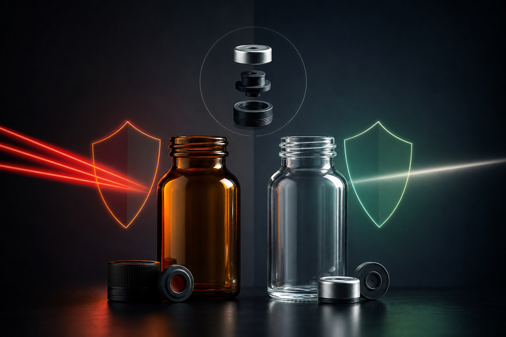

Choosing the right glass bottle for medicine looks straightforward until you're deep into a product development cycle and realize the decisions you made early are now locked in. Get the glass type wrong and a light-sensitive formulation degrades before it reaches the patient. Choose the wrong closure and you're looking at leakage, contamination risk, or a failed child-resistance test. For procurement managers and brand owners sourcing pharmaceutical packaging, these choices happen early and are difficult to reverse once tooling is committed.

This article covers the two primary glass color options for pharmaceutical bottles, explains when each is appropriate, and walks through the closure standards that matter most when specifying a glass bottle for medicine.

---

## Why Glass Remains the Standard for Pharmaceutical Packaging

Glass has held its position in pharmaceutical packaging for good reason. It is chemically inert, meaning it won't react with the vast majority of drug formulations. Paired with the right closure, it creates a true hermetic seal. It is impermeable to gases and moisture. And it supports sustainability goals in a way that single-use plastics increasingly cannot.

For buyers sourcing at volume, glass also offers long-term supply stability and compatibility with established regulatory frameworks across the US, EU, and Asia-Pacific markets. When a formulation needs a container that won't interact with its contents over a two- or three-year shelf life, glass is typically the first material evaluated — not the fallback.

---

## Amber Glass vs Clear Glass: What Actually Differs

The color of a pharmaceutical glass bottle is not aesthetic. It is functional. The choice between amber and clear comes down to one thing: how sensitive the product inside is to light.

### Amber Glass: Protection from Light Degradation

Amber glass filters out ultraviolet and visible light in the wavelength range most damaging to pharmaceutical compounds. Many active ingredients — certain antibiotics, vitamins, and liquid formulations among them — degrade when exposed to light. Amber glass acts as a physical barrier, slowing or preventing that degradation without requiring any change to the formulation itself.

For this reason, amber is the default specification for:

- Liquid oral medications, particularly syrups and suspensions
- Vitamins and nutraceuticals with light-sensitive active compounds
- Tinctures and herbal extracts
- Injectable preparations stored outside refrigeration

Amber is also the more conservative choice when a formulation hasn't been fully tested for light stability. If there's any doubt, amber is the safer call.

### Clear Glass: Visibility and Formulation Confidence

Clear glass offers full visibility of the contents — which matters in clinical settings where a pharmacist or nurse needs to inspect a solution for particulates, discoloration, or sedimentation before administration. It also matters for consumer-facing products where appearance is part of the brand experience.

Clear glass is appropriate when:

- The formulation has been validated as light-stable through photostability testing
- Visual inspection is a required step in the dispensing or administration process
- The product is stored in secondary packaging, such as a carton, that provides light protection independently
- The brand requires product visibility as part of its presentation

Clear glass is not a lower-quality option. It's simply the right option for a different set of conditions.

### Glass Type I, II, and III: The Underlying Material Classification

Beyond color, pharmaceutical glass is classified by chemical resistance. Type I borosilicate glass offers the highest chemical durability and is used for injectables and highly sensitive formulations. Type II treated soda-lime glass suits most aqueous preparations. Type III soda-lime glass is used for solid dosage forms and some oral liquids where chemical resistance requirements are less stringent.

Both amber and clear glass are available across all three types. When specifying a glass bottle for medicine, color and glass type are separate decisions that need to be made together.

---

## Closure Standards for Pharmaceutical Glass Bottles

The bottle is only half the specification. The closure system determines whether the container actually protects the product, complies with regulations, and works safely in the hands of the end user.

### Screw Caps and Continuous Thread Closures

Screw caps are the most common closure for oral liquid pharmaceuticals. They're straightforward to apply and remove, compatible with automated filling lines, and available with a wide range of liner materials to create a chemical-compatible seal.

The liner material matters more than the cap itself. Foam liners work for many oral liquids. Foil-laminated liners are used when a stronger barrier against moisture or oxygen is needed. Specifying the wrong liner can allow vapor transmission or chemical migration — both of which affect product stability.

### Child-Resistant Closures

Child-resistant (CR) closures are a regulatory requirement in most major markets for medications that pose a risk to children. In the United States, the Poison Prevention Packaging Act sets the standard. The European Union has its own equivalent requirements. Many markets in Southeast Asia and the Asia-Pacific region align with or reference these frameworks.

CR closures typically use a push-and-turn or squeeze-and-turn mechanism that requires two simultaneous actions to open. They must pass specific torque and panel testing protocols to demonstrate that children below a defined age cannot open them, while adults can.

If you're sourcing pharmaceutical glass bottles for export across multiple markets, confirming that your closure meets the CR standard in each destination country is a procurement-level responsibility — not something to resolve after the product has launched.

### Tamper-Evident Bands and Induction Seals

Tamper-evident features are now standard practice rather than optional. A breakaway band on a screw cap provides visible evidence that the bottle hasn't been opened since it left the filling facility. Induction seals — where a foil membrane is heat-bonded to the bottle mouth — provide a secondary layer of protection and are common in over-the-counter products sold through retail channels.

Both features serve a dual function: they protect the product and they protect the brand. A tamper-evident failure in the field is a recall risk, not just a quality issue.

### Dropper Assemblies and Specialty Closures

For ophthalmic preparations, ear drops, and certain oral liquids requiring precise dosing, dropper assemblies replace standard screw caps. These consist of a rubber bulb, a glass or plastic dropper tube, and a screw cap that holds the assembly in place. The dropper tip diameter determines drop size — a dosing specification, not just a packaging preference.

Other specialty closures include pump dispensers for topical preparations, spray caps for nasal or oral sprays, and rubber-stoppered vials for injectables. Each has its own compatibility requirements with both the glass container and the formulation.

---

## What to Confirm Before Finalizing Your Specification

When sourcing a glass bottle for medicine, the specification conversation with your supplier should cover at minimum:

**Glass color and type:** Amber or clear, and which chemical resistance class is required for your formulation and regulatory pathway.

**Neck finish and thread standard:** The neck finish must match the closure exactly. Thread standards vary by region and by closure manufacturer. A mismatch here means the closure won't torque correctly on the filling line.

**Capacity and dimensional tolerances:** Pharmaceutical filling lines run to tight tolerances. Dimensional variation in the bottle affects fill accuracy and capping performance.

**Closure compatibility and liner material:** Confirm that the liner material is chemically compatible with your formulation and that the closure has been tested with the specific bottle neck finish you're using.

**Regulatory documentation:** Depending on your market, you may need certificates of conformance, material declarations, or extractables and leachables data for regulatory submission.

**Child-resistance compliance:** Confirm which markets require CR closures and that the closure you specify has been tested to the relevant standard.

---

## Sourcing Pharmaceutical Glass Bottles from Taiwan

Taiwan has a well-established glass manufacturing base, and for buyers in Southeast Asia, Japan, and the broader Asia-Pacific region, sourcing from a Taiwan-based manufacturer offers real supply chain advantages over European or North American alternatives. Lead times are shorter, freight costs are lower, and there's no currency or geopolitical exposure from routing pharmaceutical packaging through Europe.

[Hwa Hsia Glass](https://hwahsiaglass.com), founded in 1925 and operating as Taiwan's largest household glass bottle manufacturer, produces pharmaceutical bottles as part of a multi-vertical catalog that also covers food, beverage, wine, and cosmetics packaging. The pharmaceutical line is supported by documented quality certifications and published QC performance metrics — both of which matter when you need to submit supplier qualification documentation as part of a regulatory filing.

For buyers who need both standard catalog options and custom designs, Hwa Hsia handles the full process from design through production, post-processing, and finished packaging. That end-to-end capability reduces the number of vendors you need to manage and simplifies the documentation chain for quality audits.

---

## FAQs

**What is the main difference between amber and clear glass bottles for medicine?**
Amber glass filters ultraviolet and visible light, protecting light-sensitive formulations from degradation. Clear glass allows full visibility of the contents and is appropriate when the formulation has been validated as light-stable or when visual inspection is required before use.

**What does glass Type I, II, or III mean for pharmaceutical bottles?**
These classifications describe the chemical resistance of the glass. Type I borosilicate glass has the highest resistance and is used for injectables and sensitive formulations. Type II treated soda-lime glass suits most aqueous preparations. Type III soda-lime glass is used for solid dosage forms and some oral liquids. Color and glass type are separate specifications.

**Are child-resistant closures required for all medicine bottles?**
Not for all, but for most medications that present a risk to children in major markets including the United States and the European Union. Requirements vary by market and product category. If you're exporting to multiple countries, you need to confirm the CR standard for each destination.

**What is an induction seal and when is it required?**
An induction seal is a foil membrane heat-bonded to the bottle mouth during or after filling. It provides tamper evidence and an additional barrier against moisture and oxygen. It's common in retail over-the-counter products and increasingly expected by retail buyers as a baseline quality signal.

**Can the same glass bottle be used with different closure types?**
Only if the neck finish is compatible. The neck finish — meaning the thread standard and outer diameter at the bottle mouth — must match the closure specification exactly. A bottle designed for one closure type won't perform correctly with a different closure unless the neck finish is the same.

**What documentation should I request from a pharmaceutical glass bottle supplier?**
At minimum: certificates of conformance for the glass material, dimensional inspection reports, liner material declarations, and any extractables and leachables data relevant to your formulation. For regulatory submissions in the US or EU, you may also need a Drug Master File reference or equivalent documentation.

**Why source pharmaceutical glass bottles from Taiwan rather than Europe?**
For buyers in Southeast Asia, Japan, and the Asia-Pacific region, Taiwan-based manufacturing offers shorter lead times, lower freight costs, and supply chain proximity. The three largest global glass manufacturers — O-I, Ardagh, and Verallia — have no meaningful Asia-Pacific manufacturing presence, which makes Taiwan a practical alternative for APAC-origin sourcing.

---

## Getting the Specification Right

The amber-versus-clear decision and the closure standard you choose are not afterthoughts. They are part of the product specification, and they need to be resolved before you finalize tooling or submit a regulatory package. Working with a supplier who understands both the technical requirements and the documentation expectations of pharmaceutical buyers makes that process faster and less prone to costly revisions.

For pharmaceutical glass sourcing from a Taiwan-based manufacturer with a documented quality system and multi-vertical production capability, explore the full range at [Hwa Hsia Glass](https://hwahsiaglass.com).
