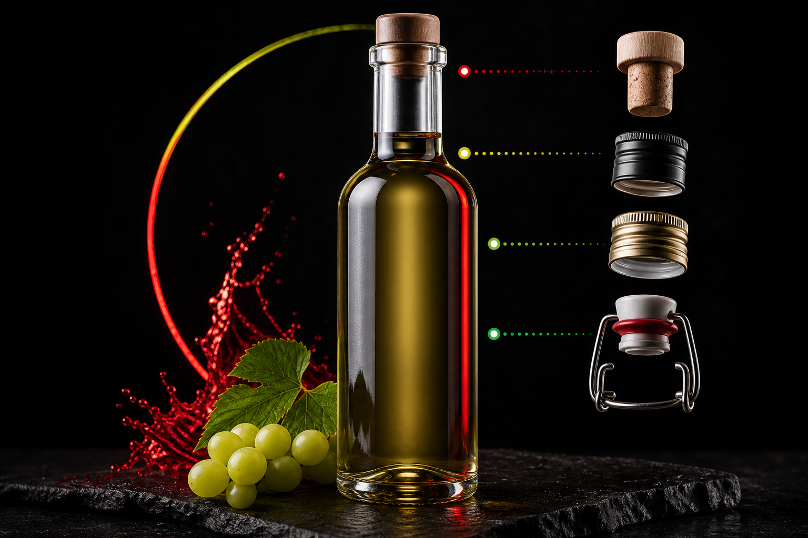

Choosing the right glass bottle for vinegar isn't as simple as picking a shape you like. Vinegar is acidic, and over time, the wrong container or closure can compromise your product's integrity, alter its flavor, or cause sealing failures that cost you inventory and customer trust. Whether you're bottling artisan apple cider vinegar, a commercial balsamic range, or a specialty rice vinegar for retail, packaging decisions matter as much as what's inside.

This guide covers what makes glass the right material for vinegar, how acid resistance works in practice, which closure types hold up best, and what to look for when sourcing at scale.

## Why Glass Is the Right Material for Vinegar

Vinegar's acidity — typically expressed as a percentage of acetic acid — makes it reactive with many packaging materials. Plastic containers can leach compounds into acidic liquids over time, especially under heat or UV exposure. Metal closures without proper liners corrode. Glass, by contrast, is chemically inert. It doesn't react with acetic acid, doesn't absorb odors, and transfers nothing into the vinegar.

That inertness is why glass has been the default packaging material for vinegar across centuries of food production. For brands positioning their product as premium, natural, or artisan, glass also communicates quality in a way plastic simply can't match.

The practical advantages are just as real: glass is easy to clean, fully recyclable, and presents well on shelf — labels, embossing, and decorative finishes all work cleanly on glass in ways that reinforce brand identity.

## Understanding Acid Resistance in Glass Bottles

Not all glass is made to the same standard. For vinegar specifically, both the glass composition and the manufacturing process affect how well a bottle performs over its shelf life.

### Glass Type and Composition

Standard soda-lime glass — the most common type used in food and beverage containers — handles vinegar well. Its silica-based composition resists acetic acid effectively under normal storage conditions. In most vinegar applications, manufacturing consistency matters more than glass type: uniform wall thickness, no internal stress points, and a clean interior surface all reduce the risk of micro-fractures or surface degradation over time.

Borosilicate glass offers higher chemical resistance and thermal stability and is sometimes used for specialty or premium applications. For most commercial vinegar products, though, high-quality soda-lime glass performs reliably and is considerably more cost-effective at volume.

### Wall Thickness and Structural Integrity

Thicker walls aren't always better, but they do provide more resistance to mechanical stress during filling, transport, and retail handling. For bottles running through automated filling lines, consistent wall thickness is especially important — uneven walls create weak points that can crack under pressure.

When sourcing vinegar bottles, ask your supplier for quality control documentation. Certifications and published QC metrics give you a verifiable baseline for what you're ordering rather than leaving you to rely on verbal assurances.

### Interior Surface Quality

The interior surface of a glass bottle should be smooth and free of inclusions, bubbles, or irregularities. These aren't just cosmetic issues. In an acidic environment, surface defects can become sites where the liquid interacts more aggressively with the glass during long storage. A well-manufactured bottle has a consistent, clean interior that keeps the vinegar stable from production through to the consumer's shelf.

## Closure Options for Vinegar Bottles

The closure is where many vinegar packaging decisions go wrong. Acetic acid vapors are corrosive, and if your closure material isn't compatible with vinegar, you'll see corrosion, seal failure, or flavor contamination before the product reaches its best-by date.

### Cork Closures

Cork is traditional and visually appealing, particularly for artisan or premium products. It breathes slightly, which can be desirable for aged balsamic vinegars where minimal oxidation is part of the product's character. That said, cork isn't ideal for long shelf-life products or high-acidity vinegars — the acid can degrade the cork over time, producing off-flavors and eventually breaking the seal.

If you go with cork, a wax or paraffin seal over the top adds a protective layer and extends the closure's functional life.

### Metal Screw Caps with Acid-Resistant Liners

Metal screw caps are the standard for commercial vinegar. They apply consistently on automated lines and deliver a repeatable seal. The critical detail is the liner. A standard metal cap without one will corrode when exposed to acetic acid vapors inside the bottle. The liner — typically polyethylene or a vinyl-based compound — acts as a barrier between the metal and the vinegar.

When specifying metal caps for vinegar, always confirm the liner material with your closure supplier and verify it's rated for acidic food contact. A cap that performs fine on water or juice may fail within months on a vinegar product.

### Plastic Screw Caps

HDPE and polypropylene caps are both compatible with vinegar and widely used across the food industry. They're lightweight, cost-effective, and don't corrode. For vinegar products where function matters more than aesthetics — bulk or foodservice formats, for example — plastic caps are a practical choice.

For consumer-facing products, plastic can feel less premium than metal or cork, so the decision often comes down to brand positioning as much as technical requirements.

### Swing-Top or Bail Closures

Swing-top closures — sometimes called Grolsch-style or bail closures — use a ceramic or plastic stopper held in place by a wire bail. They're popular with artisan and craft vinegar brands for their visual appeal and the tactile experience they offer consumers.

Stopper material matters here. Ceramic stoppers with a rubber gasket provide a good seal, but the gasket must be food-grade and acid-resistant. Rubber gaskets can degrade with repeated vinegar exposure, so swing-top bottles are better suited to products with shorter shelf lives or presentation formats where the bottle will be refilled or reused.

### Pourers and Dispensing Closures

Specialty vinegars — particularly those sold in delicatessens, specialty food stores, or as part of a gift set — often use pourer inserts that allow controlled dispensing. These are typically stainless steel or acid-resistant plastic, sitting inside the bottle neck with a separate cap over the top.

The pourer insert must match the bottle's neck diameter, so this is a detail to nail down at the design stage, not after production. If you're commissioning a custom bottle, specifying the pourer type upfront lets your manufacturer design the neck finish to match.

## Bottle Shape and Format Considerations for Vinegar

Beyond material and closure, bottle shape affects how the product pours, how it reads on shelf, and how efficiently it ships.

### Neck Width and Pouring Control

Narrow-neck bottles give better pouring control for thin, watery vinegars like white wine vinegar or rice vinegar. Wider necks are more practical for thick, viscous products like aged balsamic, where a narrow opening can slow pouring to the point of frustrating the end user.

### Shoulder and Body Profile

Tall, narrow bottles with high shoulders are common for premium wine vinegars because they reference the visual language of wine packaging. Shorter, wider bottles are more stable in transit and on shelf — which matters for foodservice formats. Squat, wide-mouth jars work well for specialty vinegars sold as condiments or cooking ingredients.

### Label Area

If your branding depends on a large, detailed label, you need a bottle with a flat or gently curved panel that gives the label enough surface to adhere cleanly. Heavily contoured or embossed bottles can make label application difficult and push up rejection rates on automated lines.

## Custom vs. Standard Catalog Bottles for Vinegar

For many vinegar brands, a standard catalog bottle is the fastest and most cost-effective path to market. Standard formats come in a range of sizes and shapes that suit most products, with known specifications, tested quality, and shorter lead times.

Custom bottles make sense when your brand has a distinctive visual identity that standard shapes can't support, when you're launching a premium product where shelf differentiation is a strategic priority, or when you need a specific neck finish to accommodate a proprietary closure or pourer.

The practical middle ground is working with a manufacturer that offers both under one roof. You can launch with a standard bottle while your custom design is in development, then transition to the custom format without switching suppliers or requalifying a new production partner.

[Hwa Hsia Glass](https://hwahsiaglass.com), founded in 1925 and described as Taiwan's largest household glass bottle manufacturer, operates exactly this kind of catalog-plus-custom model. Their food jar and beverage bottle categories include formats suited to vinegar, and their end-to-end service covers design, production, post-processing, and finished packaging for export. For buyers in Southeast Asia, Japan, and the United States sourcing from an Asia-Pacific manufacturer, that combination of catalog depth and custom capability in a single supplier relationship simplifies procurement considerably.

## What to Ask Your Glass Bottle Supplier

The right questions separate reliable partners from those who will cause problems at scale.

Ask for documentation of their quality certifications and QC system. Ask specifically whether their bottles have been used in food-acid applications and whether they can provide references or case data. Ask about post-processing capabilities — frosted finishes, silk-screen printing, embossing — because these are often handled by separate contractors rather than in-house, which adds coordination risk.

Ask how they handle custom neck finishes and whether they can accommodate specific closure types at the design stage. Ask about their export experience, particularly if you're shipping to multiple markets with different labeling or import requirements.

A supplier with documented quality systems and genuine export experience will answer these questions directly. One that can't is a risk you don't need to take with a food product.

## FAQs

**Is glass the safest material for storing vinegar long-term?**
Yes. Glass is chemically inert and doesn't react with acetic acid, so it won't leach any compounds into the vinegar or alter its flavor over time. It's the most reliable material for long-term storage, particularly for products with higher acidity levels.

**Do I need a special type of glass for vinegar, or will standard food-grade glass work?**
Standard soda-lime glass used in food and beverage containers is well suited for vinegar. Manufacturing quality matters more than glass type — consistent wall thickness and a clean interior surface are the factors that count.

**Which closure type is best for commercial vinegar production?**
Metal screw caps with acid-resistant liners are the most practical choice for high-volume production. They apply consistently on automated lines and provide a reliable seal when the liner material is correctly specified for acidic food contact.

**Can I use cork closures for vinegar?**
Cork works for artisan or premium products, particularly aged balsamic, but it's not ideal for long shelf-life products because acetic acid can degrade it over time. A wax or paraffin seal over the cork extends its functional life.

**What should I look for in a glass bottle supplier for vinegar products?**
Prioritize suppliers with documented quality certifications, a track record in food-acid applications, in-house post-processing capabilities, and genuine export experience. Ask for QC documentation rather than accepting verbal assurances.

**How do I choose between a standard catalog bottle and a custom design?**
Standard bottles are faster to market and more cost-effective. Custom designs are worth the investment when shelf differentiation is a strategic priority or when you need a specific neck finish for a proprietary closure. Working with a supplier that offers both lets you launch quickly and transition to a custom format without changing partners.

**Does bottle shape affect how vinegar pours?**
Yes. Narrow-neck bottles give better pouring control for thin vinegars. Wider necks suit thicker products like aged balsamic. The neck finish also needs to match your chosen closure or pourer insert, so it's worth specifying both together at the design stage.

## The Right Bottle Makes a Measurable Difference

Vinegar packaging decisions aren't just about aesthetics. Glass composition, wall quality, and closure compatibility all affect whether your product reaches the consumer in the condition you intended. Getting these details right at the sourcing stage is far less expensive than dealing with seal failures, flavor issues, or returns after launch.

If you're sourcing glass bottles for vinegar and want a manufacturer with the depth to handle both standard and custom formats, end-to-end production, and reliable export to multiple markets, [Hwa Hsia Glass](https://hwahsiaglass.com) is worth a conversation. A century of manufacturing experience and a full-service model from design through finished packaging make them a practical option for brands that need more than just a bottle.
