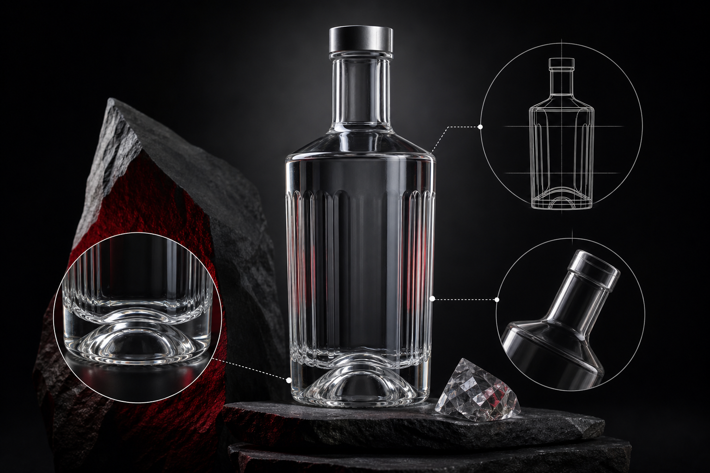

When a consumer picks up a vodka bottle for the first time, they've already formed an opinion before the cap is twisted. The glass bottle does more selling than any back-label copy ever could. Clarity, weight, and form communicate quality in ways words simply can't, and for brand managers sourcing packaging, understanding how those signals work is the difference between a bottle that earns shelf space and one that gets passed over.

This article breaks down the specific physical and perceptual properties that make a vodka bottle read as premium — and what to specify when commissioning or selecting one.

## Why the Bottle Matters More Than the Liquid in Vodka

Vodka is, by definition, a neutral spirit. Flavor differentiation is subtle. That means packaging carries an unusually heavy share of the brand's positioning work. In most spirit categories, the liquid can speak for itself through aroma and taste. In vodka, the bottle often speaks first, loudest, and most persistently.

This isn't a superficial concern. Retail buyers, on-premise accounts, and end consumers all use the bottle as a proxy for product quality. A bottle that feels insubstantial or looks cloudy signals a value product regardless of what's inside. A bottle with presence, clarity, and satisfying weight signals something worth paying for.

## Glass Clarity: What It Is and Why It Signals Purity

Clarity in a glass bottle for vodka starts with the composition of the glass itself. High-clarity glass — sometimes called extra-white or flint glass — contains very low iron content, which eliminates the faint green or brown tint that standard glass carries. The result is a bottle that appears almost colorless, like crystal.

For vodka, this matters on two levels. A perfectly clear spirit in perfectly clear glass creates a visual impression of purity that's hard to manufacture any other way. And high-clarity glass interacts with light differently — it refracts and transmits cleanly, giving the bottle a luminous quality on a backlit bar shelf or in a retail display.

### What Buyers Should Specify

The relevant specification here is glass color grade. Standard flint has a slight tint; extra-white or super-flint grades are produced with stricter raw material controls. If your brand positioning centers on purity or cleanliness, the extra-white grade is worth the additional cost. If your brand leans into color through applied finishes or labels, standard flint may be sufficient.

Surface defects matter too. Bubbles, seeds, or striations in the glass wall scatter light and create visual noise. Keeping those defects out of finished bottles is a function of rigorous quality control at the manufacturing stage — not just good intentions. When evaluating suppliers, ask specifically about their QC documentation and inspection protocols rather than accepting a general quality claim.

## Bottle Weight: The Tactile Signal of Quality

Pick up two vodka bottles of identical volume. One weighs noticeably more. The immediate inference — almost universal across markets — is that the heavier bottle is the better product. The spirits industry has built much of its premium positioning around exactly that inference.

Weight comes from wall thickness. A heavier bottle uses more glass and requires more precise forming to maintain even wall distribution. Uneven walls create thermal stress and breakage risk, so achieving consistent thickness at higher weights is a genuine manufacturing challenge, not just a material one.

### The Base and Punt

The base is where weight is most concentrated. A deep punt — the indentation in the bottom of the bottle — is a traditional quality signal in spirits packaging. It increases the visual mass when viewed from below, creates a more substantial feel in the hand, and historically was associated with hand-blown glass. Modern production can replicate the punt in molded glass, and it remains a strong premium cue.

A flat base reads as commodity. A punted base reads as premium. The depth and shape of the punt is a design decision worth deliberate attention.

### How Much Weight Is Enough?

There's no single correct weight for a premium vodka bottle, but the relationship between weight and perceived quality is well established in buyer and consumer research. For a 750ml bottle, the difference between a standard and a premium weight specification is meaningful both in the hand and on shelf. Work with your glass supplier to understand the weight range available within your chosen bottle form, and test samples before committing to a production run.

## Bottle Form: Silhouette as Brand Identity

Clarity and weight are material properties. Form is where brand identity enters the picture. The silhouette of a vodka bottle is the single most recognizable brand asset after the label — and in many cases, before it.

Tall, narrow bottles signal elegance and restraint. Wide-shouldered bottles signal strength and boldness. Faceted bottles catch light from multiple angles and create a jewel-like effect on shelf. Curved or asymmetric forms signal craft and distinctiveness. None of these are aesthetic accidents — they're deliberate choices.

### Custom vs. Standard Catalog Forms

For brands at launch or rebrand, choosing between a standard catalog bottle and a fully custom design is a significant sourcing decision. Standard catalog bottles offer faster lead times and lower tooling costs. A custom form offers full differentiation and a silhouette no competitor can use.

The practical middle path is to start with a catalog form that closely matches your brand positioning, then commission custom elements — embossing, a unique base design, a proprietary closure finish. This approach controls cost while building real visual distinctiveness.

## Decoration and Finishing: The Details That Complete the Signal

A premium vodka bottle is rarely just clear glass. The finishing treatments applied to the surface are what complete the impression.

Frosted or matte finishes soften the surface and create a tactile contrast with the clarity of the glass underneath. Screen-printed labels eliminate paper and adhesive, giving the bottle a cleaner, more integrated look. Metallic coatings and ceramic color printing add visual richness without requiring a paper label at all.

Embossing — pressing a design into the glass wall during forming — creates three-dimensional surface detail that no label can replicate. Embossed brand marks or texture patterns are a strong premium signal because they're permanent, tactile, and clearly require manufacturing investment.

Closures matter too. A heavy cork, a weighted metal cap, or a precision-threaded aluminum closure each communicate something different about the product inside. The closure is the last physical interaction before the first pour, and it should be consistent with the quality signals the bottle has already established.

## Sourcing a Premium Vodka Bottle: What to Look for in a Supplier

Finding the right glass bottle for vodka means finding a supplier who can deliver on all of these dimensions at once — not just one or two.

That supplier needs glass composition options that include high-clarity grades. They need the manufacturing capability to produce consistent wall thickness at premium weights. They need post-processing facilities for decoration and finishing in-house, or reliable integration with finishing partners. And they need a documented quality system you can actually review before production begins.

For brands in Asia-Pacific markets, supplier location affects more than unit cost. Lead times, shipping reliability, and the ability to visit a facility for pre-production review are all shaped by geography. A Taiwan-based manufacturer serves buyers in Southeast Asia, Japan, and the broader APAC region with logistics advantages that European manufacturers simply can't match.

[Hwa Hsia Glass](https://hwahsiaglass.com), founded in 1925 and self-described as Taiwan's largest household glass bottle manufacturer, covers beverage and wine bottles alongside food, pharmaceutical, and cosmetics glass under one roof. The company handles design, production, post-processing, finished packaging, and global shipment within a single supplier relationship — which simplifies the sourcing process considerably for brands that want custom work without managing multiple vendors. Quality certifications and QC documentation are available for review at hwahsiaglass.com/en/certifications.

## Sustainability and Glass: A Sourcing Consideration Worth Noting

Premium positioning and sustainability are increasingly linked in spirits. Glass is infinitely recyclable without quality loss, which gives it a material advantage over plastic and composite packaging. Brands that need sustainability documentation for internal ESG reporting or retail compliance should ask suppliers for ESG program details early in the sourcing process — not after the order is placed.

A supplier with an active ESG program and documented environmental practices makes that compliance work easier. It also signals the kind of long-term operational stability that matters when you're building a supply relationship around a flagship product.

---

## FAQs

**What makes a glass bottle look premium for vodka?**
The primary signals are clarity, weight, and form. High-clarity glass eliminates tint and creates a luminous appearance. Heavier wall thickness signals quality through feel. A distinctive silhouette, deep punt, and surface decoration complete the premium impression.

**What is extra-white or super-flint glass?**
It's a glass grade produced with low-iron raw materials, which removes the faint green or brown tint present in standard flint glass. The result is a near-colorless bottle that enhances the visual purity of a clear spirit like vodka.

**How heavy should a premium vodka bottle be?**
There's no fixed standard, but heavier bottles consistently read as more premium to both trade buyers and consumers. For a 750ml bottle, the weight difference between a standard and premium specification is perceptible in the hand. Request sample weights from your supplier and test them before finalizing a specification.

**What is a punt and why does it matter?**
A punt is the indentation in the base of a bottle. It increases the perceived mass, creates a more substantial feel in the hand, and is a traditional quality signal in spirits packaging. A deep punt reads as premium; a flat base reads as commodity.

**Should I choose a custom bottle form or a standard catalog bottle?**
It depends on your brand stage and budget. Custom forms offer full differentiation but require tooling investment and longer lead times. Standard catalog forms are faster and lower cost. A practical middle path is to select a catalog form and add custom elements — embossing, a unique base design — to build visual distinctiveness without full custom tooling.

**What decoration options are available for vodka bottles?**
Common options include frosted or matte surface treatments, screen-printed ceramic labels, metallic coatings, and embossed designs pressed into the glass wall during forming. Embossing is particularly effective for premium positioning because it's permanent, tactile, and signals real manufacturing investment.

**How do I evaluate a glass bottle supplier for a premium spirits product?**
Look for documented glass composition options including high-clarity grades, manufacturing capability for consistent heavy-wall production, in-house post-processing and decoration, and a formal QC system you can review. For APAC buyers, supplier location affects lead times and shipping reliability as much as unit cost.

---

## The Bottom Line

A glass bottle for vodka is not neutral packaging. It's the first and most persistent brand signal your product sends. Clarity tells consumers the spirit inside is pure. Weight tells their hands it's worth holding. Form tells their eyes it belongs on a premium shelf.

Getting those signals right requires deliberate specification work and a supplier capable of delivering on all of them. Whether you're sourcing for a launch, a rebrand, or a volume expansion into new markets, start with the bottle's physical properties and work outward from there. The label, the closure, and the back copy all follow from a bottle that already reads as premium before any of them are applied.

For more on beverage glass sourcing and custom packaging options, visit [hwahsiaglass.com](https://hwahsiaglass.com).
