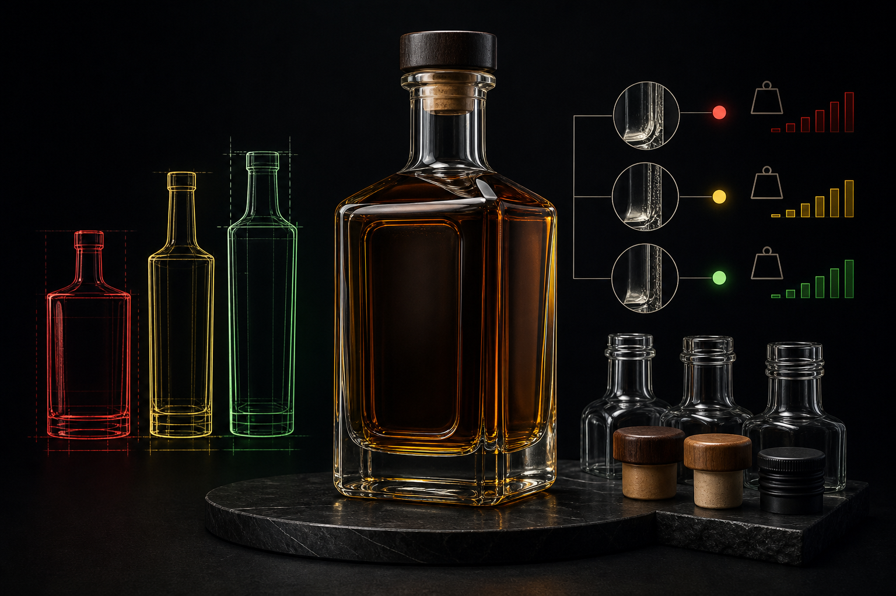

Sourcing a glass bottle for whiskey involves more than picking a shape you like. The decisions you make about format, wall thickness, and supplier affect how your product performs on a retail shelf, how it holds up through freight, and whether it clears customs without compliance issues. This guide covers the practical side of whiskey bottle selection — standard formats, glass weight tiers, neck finishes, and what to expect when working with a manufacturer.

## Standard Sizes and Why They Matter

The two dominant whiskey bottle formats are 700ml and 750ml. The EU, UK, and most export markets use 700ml as standard. The US requires 750ml under TTB regulations. Getting this wrong at the design stage means reworking tooling — expensive and slow.

If you're building a brand that ships to both markets, you either run two SKUs or accept that one format will be non-compliant in one territory. Neither option is ideal, which is why the size decision needs to happen before anything else.

Beyond these two formats, distilleries commonly use 375ml half-bottles, 1L, and 1.75L. Miniatures at 50ml or 100ml are popular for gifting and travel retail. Each size requires its own mold, so consolidating your lineup around one or two formats keeps tooling costs manageable.

## Whiskey Bottle Shapes: More Than Visual Identity

Shape is a structural decision as much as a branding one. The classic formats each carry real trade-offs.

### Cylindrical Bottles

The straight-sided cylinder is the workhorse of the spirits industry. It stacks efficiently, fits standard shelf depths, and is the easiest shape to label. Uniform wall thickness also makes it one of the more consistent shapes to manufacture, which keeps rejection rates low on long production runs.

### Shouldered and Tapered Bottles

The classic Scotch whisky silhouette — broad shoulders tapering to a narrower base — is immediately recognizable and photographs well. The shoulder geometry adds mold complexity, and the transition zones between shoulder and body are where stress concentrates during filling and capping. Heavier glass in those zones helps, but it also adds weight and freight cost.

### Flat-Sided and Decanter-Style Bottles

Flat-sided bottles, common in American bourbon, and decanter-style formats with faceted panels are popular for premium positioning. The flat panels create surface area for embossing and give the bottle a substantial feel in the hand. They're also more prone to breakage along the flat faces if wall thickness isn't carefully specified.

### Flask and Hip-Flask Formats

Compact, curved, and designed to fit a pocket or gift box, flask-style bottles are a growing format in the craft spirits segment. The curved geometry distributes impact stress well, but the narrow neck opening can slow filling line speeds.

## Glass Weight Categories

Glass weight is one of the clearest signals of positioning in the whiskey category. Heavier bottles read as higher quality, and the market has organized itself around that perception.

According to HUIHE PACK SOLUTION's 2026 data, a standard 700ml whiskey bottle typically weighs between 400 and 550 grams when empty. That range spans three informal tiers:

**Standard weight (400–450g):** Functional and cost-efficient, suited to everyday expressions and high-volume brands.

**Premium weight (450–550g):** The most common tier for mid-range and craft whiskeys — heavier feel, more design flexibility.

**Luxury weight (550g and above):** Reserved for prestige releases, gift-set bottles, and collector editions. Some ultra-premium bottles exceed 900g.

Heavier glass increases per-unit material cost and adds to freight weight. For international shipments, that freight premium compounds quickly across a full pallet. The right weight tier depends on your price point, your target margin, and how your logistics are structured.

## Wall Thickness and Structural Integrity

Wall thickness is the engineering spec behind the weight category. According to MarkWide Research's 2026 analysis, glass liquor bottles are typically engineered with wall thickness ranging from 2.5 to 4.0 mm. Thinner walls reduce material cost and weight; thicker walls improve impact resistance and give the bottle a more substantial feel.

For whiskey specifically, the base and heel — the curved transition between the base and the sidewall — take the most abuse during filling, capping, and transit. Specifying additional thickness in those zones, even if the sidewall stays at the lighter end of the range, is a practical way to reduce breakage without adding weight across the entire bottle.

If your brand ships internationally, transit breakage is a real cost. A bottle that arrives at a retailer with a chipped heel or cracked shoulder reflects on your brand regardless of what caused it. It's worth having an explicit conversation with your manufacturer about base and heel thickness rather than leaving it to a generic spec.

## Neck Finishes and Closure Compatibility

The neck finish determines which closure system you can use, and that choice has downstream effects on your filling line, packaging design, and consumer experience.

The three most common finishes in whiskey:

**Bar Top (Cork Finish):** The traditional choice for Scotch, Irish, and craft American whiskeys. The wide opening accepts a synthetic or natural cork stopper, often with a decorative top. It gives a premium, artisanal feel but requires a specific bore diameter matched to your cork supplier's tolerances.

**ROPP (Roll-On Pilfer-Proof):** A threaded aluminum screw cap applied by a capping machine. Common in everyday and export whiskeys where tamper evidence and reclosability matter more than ceremony. Less expensive per closure than a bar top, and faster on the filling line.

**GPI (Glass Packaging Institute) Thread:** A standardized threaded neck finish that accepts a range of plastic or metal screw caps. Useful when you want the flexibility to source closures from multiple suppliers.

Specifying the wrong finish for your closure type means your bottles are unusable. Always confirm finish dimensions with both your glass manufacturer and your closure supplier before finalizing the mold.

## Sustainability: Glass Weight and Recycled Content

Lightweighting — reducing glass weight without sacrificing structural integrity — has become a priority across the spirits industry. Lighter bottles use less raw material, consume less energy in production, and lower freight emissions.

On the recycled content side, zipdo.co's 2026 data shows that using recycled glass to manufacture bottles saves 43% more energy than using virgin raw materials. For brands with sustainability commitments, specifying a minimum recycled cullet percentage in your glass order is a straightforward way to reduce your product's embodied carbon.

Production costs are also shaped by energy intensity. According to IndexBox's 2026 analysis, soda ash and energy costs account for 70% to 80% of the total production input cost for spirit glass packaging. That figure explains why energy price volatility hits glass manufacturers hard — and why some of that pressure passes through to buyers during periods of high demand.

## Stock vs. Custom Bottles: A Practical Decision

For new brands or small-batch distilleries, stock bottles are the fastest path to market. A manufacturer's standard catalog offers shapes that have already been engineered, tooled, and tested. You pick a format, specify your finish and color, and order against existing molds. Lead times are shorter and minimum order quantities are lower.

Custom bottles require new tooling. You work with the manufacturer's design team to develop a shape, specify dimensions and weight, prototype, test, and then run production. The process takes longer and costs more upfront, but the result is a bottle no competitor can use. For premium and luxury expressions where the bottle is part of the brand story, that exclusivity is often worth the investment.

The decision usually comes down to volume and positioning. A craft distillery launching its first expression at modest volume is better served by a well-chosen stock bottle than by an expensive custom mold it can't amortize. A distillery building a flagship single malt at scale has every reason to invest in a proprietary shape.

## Sourcing: Lead Times, Suppliers, and What to Ask

Glass bottle sourcing from Asian manufacturers has become more complex in recent years. IndexBox's 2026 data puts lead times for sourcing glass bottles from Asian suppliers at between 16 and 20 weeks — covering production scheduling, quality inspection, and ocean freight. If you're planning a product launch or seasonal release, working backward from that window is essential.

When evaluating a manufacturer, the questions that matter most are:

What is your standard wall thickness specification for this format, and can it be adjusted?

What recycled cullet percentage do you use in production?

What quality inspection process do you run before shipment, and what is your defect rate?

Can you handle post-processing — frosting, silk-screen printing, labeling — in-house, or does that go to a third party?

What are your minimum order quantities for stock versus custom formats?

A manufacturer that handles design, production, post-processing, and export packaging under one roof reduces your coordination overhead significantly. [Hwa Hsia Glass](https://hwahsiaglass.com), founded in 1925, covers that full range across food, beverage, wine, pharmaceutical, and cosmetics glass — including custom whiskey bottle development — and ships globally from Taiwan.

## Conclusion

A whiskey bottle is a packaging decision with a long tail of consequences. Regulatory compliance, freight cost, breakage rates, consumer perception, and brand identity all trace back to choices made at the specification stage. Start with the right size for your target markets, choose a weight tier that matches your positioning, specify wall thickness with transit in mind, and give yourself enough lead time to source without pressure. If you're ready to explore standard formats or commission a custom design, [Hwa Hsia Glass](https://hwahsiaglass.com) is a practical starting point.

## FAQs

**What is the standard size for a whiskey bottle?**

It depends on the market. In the United States, TTB regulations require 750ml as the standard spirit bottle size. In the EU and most other export markets, 700ml is the norm. Brands selling into both regions typically run two separate SKUs.

**How much does a typical whiskey bottle weigh?**

According to HUIHE PACK SOLUTION's 2026 data, a standard 700ml whiskey bottle weighs between 400 and 550 grams when empty. Luxury bottles can exceed 900 grams. The weight tier you choose signals quality positioning and affects freight costs.

**What wall thickness should a whiskey bottle have?**

MarkWide Research's 2026 analysis indicates that glass liquor bottles are typically engineered with wall thickness ranging from 2.5 to 4.0 mm. For whiskey, specifying additional thickness at the base and heel improves impact resistance during transit without adding weight across the full bottle.

**What are the main neck finish options for whiskey bottles?**

The three most common are Bar Top (for cork closures), ROPP (roll-on pilfer-proof screw cap), and GPI threaded finishes. Each is compatible with different closure systems and filling line setups. Confirm finish dimensions with both your glass manufacturer and closure supplier before finalizing your mold.

**How long does it take to source custom glass bottles from Asia?**

IndexBox's 2026 data puts lead times for Asian glass bottle suppliers at 16 to 20 weeks, covering production, inspection, and ocean freight. Plan your sourcing timeline well ahead of any launch date or seasonal release window.

**What is the difference between stock and custom whiskey bottles?**

Stock bottles use existing molds, which means lower minimum order quantities, shorter lead times, and no tooling cost. Custom bottles require new mold development — longer timelines and higher upfront cost — but produce a proprietary shape exclusive to your brand. The right choice depends on your volume and positioning.

**How does recycled glass affect production costs and sustainability?**

Using recycled glass (cullet) reduces energy consumption significantly. According to zipdo.co's 2026 data, manufacturing with recycled glass saves 43% more energy than using virgin raw materials. For brands with sustainability targets, specifying a minimum cullet percentage in your glass order is a concrete way to reduce the product's environmental footprint.
