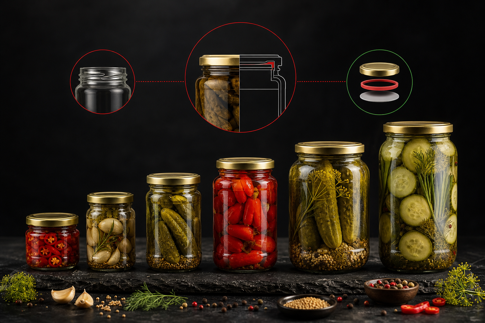

Choosing the right glass jar for pickling looks straightforward until you're deep in a sourcing conversation and realize how many variables actually matter. The jar has to survive thermal processing, hold a reliable seal through months of shelf life, present well at retail, and make it through shipping intact. For food brands buying at volume, getting this wrong means spoilage claims, retailer rejections, or a product launch that stalls before it gains traction.

This article covers the practical side: which sizes suit which products, how different seal types perform under real conditions, and what procurement teams should actually be evaluating when they write pickling jar specifications.

---

## Why Glass Remains the Right Choice for Pickled Products

Pickled foods are acidic by nature. Vinegar-based brines, fermented vegetables, and acidified sauces all create an environment that reacts with many packaging materials over time. Glass is chemically inert — the brine doesn't leach anything from the container, and the container doesn't absorb flavors, colors, or odors from the product.

That inertness matters commercially. Retailers and food safety auditors expect packaging that doesn't compromise what's inside, and glass gives you a clean answer to that question. It's also transparent, which lets consumers see exactly what they're buying. For premium pickled products especially, visibility is a genuine selling point.

Glass is also compatible with hot-fill and pasteurization processes, which most commercial pickling operations rely on. Plastic alternatives often require reformulating the filling process. Glass doesn't.

---

## Glass Jar Sizes for Pickling: Matching Capacity to Product Type

Size selection isn't arbitrary. The right capacity depends on the product format, the target consumer, and the retail channel.

### Small Jars: 100 ml to 250 ml

These work well for specialty or premium pickles sold at higher price points — cornichons, pickled capers, artisan kimchi, single-serve condiment formats. They also suit foodservice trial packs and gift sets. The smaller footprint means higher per-unit cost relative to product weight, so they're most defensible when the brand supports a premium margin.

### Mid-Range Jars: 300 ml to 500 ml

This is the most common range for retail pickling products. Pickled cucumbers, mixed vegetable antipasto, pickled onions, and similar products typically land here. The 400 ml to 500 ml range is a strong fit for weekly household use — the consumption pattern most grocery buyers optimize for. Shelf presence is solid, and the size accommodates both whole and sliced formats.

### Large Jars: 700 ml to 1 Liter and Above

Bulk retail, club store formats, and foodservice supply all use larger jars. A 1-liter jar is standard for restaurant supply of pickled jalapeños, giardiniera, and similar high-volume condiments. Larger jars require thicker glass walls and stronger closures to handle the weight and internal pressure during processing, so wall thickness needs to be an explicit part of the specification conversation with your supplier.

### Wide-Mouth vs. Narrow-Mouth

For pickling, wide-mouth openings are almost always the better choice. They allow whole vegetables to be packed without damage, make filling lines more efficient, and give consumers easier access to the product. Narrow-mouth jars are better suited to liquid-dominant products like pickled brine shots or drinking vinegars where pouring is the primary use.

---

## Seal Types: What Works for Pickled Foods

The seal is where most pickling failures originate. A jar that looks fine coming off the line can fail in transit, in the warehouse, or on the shelf if the closure system isn't matched to the processing method.

### Twist-Off Lids (PT and TO Closures)

Press-twist and twist-off metal lids are the dominant closure for commercial pickling. They create a vacuum seal during hot-fill or pasteurization — both a quality indicator and a safety signal for consumers. The audible pop when a new jar is opened is a feature, not a coincidence. These lids are compatible with automated capping lines and come in a wide range of diameters to match standard jar finishes.

The lid diameter must match the jar finish precisely. Mismatches cause seal failures at scale, and they're one of the most common sourcing errors when brands switch suppliers mid-production.

### Lug Caps

Lug caps use a multi-point locking mechanism rather than a continuous thread. They're faster to apply and remove than standard twist-offs, which makes them popular on high-speed filling lines. They perform well for hot-fill pickling applications and are common in European and Asian markets. If your target retail market is Southeast Asia or Japan, your supplier should already be familiar with lug cap specifications.

### Clamp and Bail Closures

Rubber-gasket bail closures are used for artisan and premium pickling products. They create a strong visual cue of quality and are popular with specialty food brands. That said, they're not suitable for pressure canning and require careful quality control on the rubber gasket to maintain consistent seal integrity. For brands targeting premium retail or direct-to-consumer channels, they're worth considering. For mainstream grocery at scale, they add cost and complexity without proportionate benefit.

### Continuous Thread (CT) Closures

Standard screw-cap closures work for refrigerated pickles and products that don't undergo thermal processing. They're not recommended for shelf-stable hot-fill pickling because they don't create the vacuum seal that thermal processing requires.

---

## Glass Specifications That Actually Matter at Scale

When procurement teams write jar specifications, these are the parameters that determine whether the jar performs in production and holds up on shelf.

**Wall thickness and thermal shock resistance.** Pickling jars go through significant temperature changes during hot-fill or pasteurization. Thin-walled jars crack. Your supplier should be able to confirm that the glass formulation and wall thickness are appropriate for your filling temperature.

**Finish diameter tolerance.** The finish is the threaded or lug opening at the top of the jar. Tight tolerances here are non-negotiable for automated capping. Even small deviations cause cap application failures that shut down filling lines.

**Base stability.** Jars that rock or tilt on a flat surface create problems on conveyor systems and in retail display. This is a quality control issue, not just an aesthetic one.

**Verticality and weight consistency.** Label application equipment is calibrated to jar geometry. If jars vary in height or circumference, label placement shifts and you end up with visible quality problems at retail.

**Color options.** Clear glass is standard for most pickled vegetables because consumers want to see the product. Amber glass is sometimes used for fermented products where light exposure affects quality. Green glass is less common for pickling but appears in some premium and artisan formats.

---

## What Food Brands Should Ask Their Glass Supplier

Sourcing pickling jars is a specification conversation, not just a catalog search. These are the questions worth asking before you commit to a supplier.

**Can you supply samples for line trials before we commit to volume?** Filling line compatibility needs to be verified with actual production equipment, not assumed from drawings.

**What quality documentation do you provide?** Food brands operating in regulated markets need certifications and documented QC processes. A supplier who can't produce quality documentation creates compliance risk for your business.

**Do you offer custom sizing or finish modifications?** Standard catalog sizes may not match your product format exactly. A supplier with custom design capability can adjust dimensions, finish diameter, or glass weight to fit your line — without requiring you to adapt your process to their catalog.

**What is your export experience in our target market?** Shipping glass at volume requires experience with palletization, cushioning, and customs documentation. A supplier with stable annual export volumes to your region is a lower-risk choice than one entering that market for the first time.

**What is your approach to ESG?** This matters increasingly to retail buyers and brand owners with sustainability commitments. A supplier with a documented ESG program covering environmental, social, and governance dimensions gives you something concrete to reference in your own reporting.

---

## Working with a Glass Manufacturer for Pickling Jars

For mid-to-large food brands, working directly with a manufacturer rather than a distributor gives you more control over specifications, quality documentation, and lead time visibility. It also opens the door to custom work when your product or brand positioning requires something the standard catalog doesn't cover.

Hwa Hsia Glass, founded in 1925 and identified as Taiwan's largest household glass bottle manufacturer, produces food jars as one of its five core product verticals. The catalog covers standard sizes across common pickling formats, and the custom solution service handles design, production, post-processing, and finished packaging within a single supplier relationship. The company ships globally with stable annual export volumes and maintains a formal QC system with published quality performance metrics. For procurement teams in Southeast Asia, Japan, the United States, or other markets that benefit from APAC-origin supply, that combination of catalog depth, custom capability, and documented quality is worth a closer look.

---

## Conclusion

Pickling jars are a functional specification, not a commodity purchase. Size, seal type, glass thickness, finish tolerance, and supplier quality documentation all affect whether your product performs in production, survives distribution, and earns repeat placement at retail. Start with the size and seal type that match your product format and filling process, then work back to the supplier who can meet those specifications with documented quality and reliable export capability.

---

## FAQs

**What size glass jar is best for pickling cucumbers?**
For retail, 400 ml to 500 ml wide-mouth jars are the most common choice. They accommodate whole or sliced cucumbers, work well on standard filling lines, and match the weekly household consumption pattern that grocery buyers favor. Larger formats in the 700 ml to 1-liter range are used for foodservice and club store channels.

**What type of lid seal is recommended for shelf-stable pickled products?**
Twist-off (PT or TO) metal lids and lug caps are both well-suited to shelf-stable hot-fill pickling. Both create a vacuum seal during thermal processing, which is the standard for commercial shelf-stable pickled foods. Continuous thread screw caps are better suited to refrigerated products that don't undergo pasteurization.

**Why is glass preferred over plastic for pickling?**
Glass is chemically inert and doesn't react with acidic brines. It doesn't absorb flavors or odors, doesn't leach compounds into the product, and is compatible with hot-fill and pasteurization processes without requiring changes to the filling line. It also provides the transparency consumers expect from pickled products.

**What does "finish diameter" mean and why does it matter?**
The finish is the opening at the top of the jar, including the thread or lug profile. The finish diameter must match the lid specification precisely. Mismatches between jar finish and closure cause seal failures on automated capping lines and are one of the most common sourcing errors when brands change glass suppliers.

**Can I order custom-sized pickling jars, or am I limited to standard catalog sizes?**
Many glass manufacturers offer both catalog and custom options. Custom sizing lets you match jar dimensions to your specific product format, filling equipment, and shelf space requirements. When evaluating suppliers, ask whether their custom service covers design, mold production, and post-processing — or only some of those steps.

**What quality documentation should I request from a glass jar supplier?**
At minimum, request evidence of a formal QC system, any applicable certifications, and documented quality performance metrics. For regulated food markets, you may also need material safety documentation and compliance records relevant to your target market's food contact regulations.

**How do I evaluate a glass supplier's export capability for my region?**
Ask for evidence of stable annual export volumes to your target region, references from buyers in similar markets, and specifics about their palletization and packaging practices for international shipment. A supplier with documented export history to your region carries lower logistics risk than one that's new to that shipping lane.
