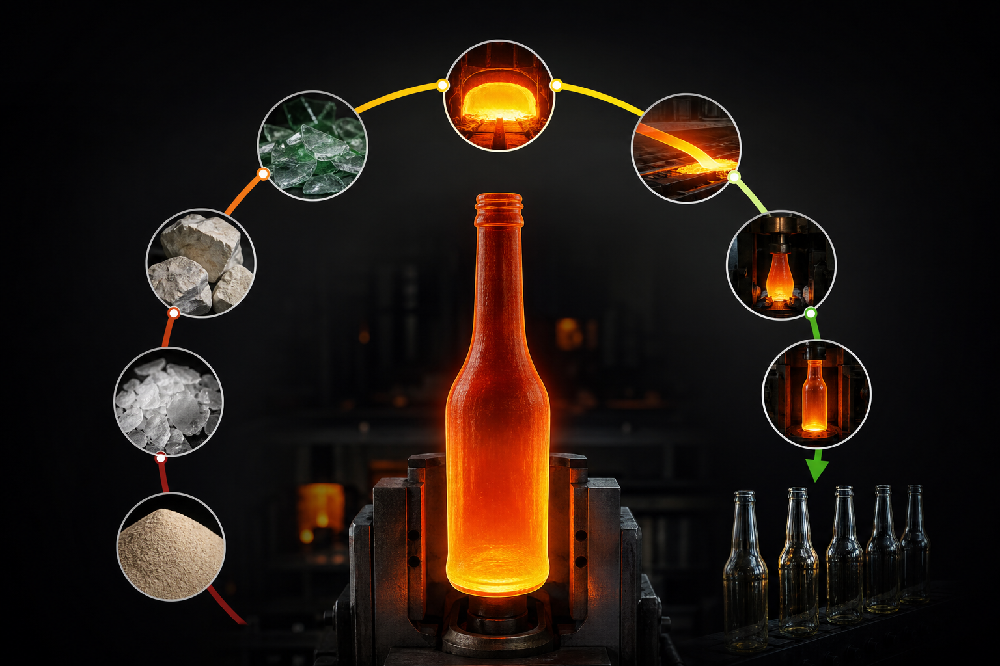

The glass manufacturing process takes a handful of raw minerals and turns them into one of the most durable, chemically inert, and visually compelling packaging materials available. Whether you're sourcing glass containers, evaluating a new supplier, or just trying to understand what actually happens between a pile of silica sand and a finished bottle on your shelf, this guide walks through every stage in plain terms.

Knowing the process also makes you a sharper buyer. Lead times, quality consistency, post-processing options, and sustainability credentials all trace back to decisions made at specific points in production.

## What Glass Is Made From

Before any melting begins, a manufacturer assembles a precise batch of raw materials. The four primary inputs are silica sand, soda ash, limestone, and cullet (recycled broken glass).

**Silica sand** is the backbone of glass. It provides silicon dioxide, which forms the three-dimensional network that gives glass its structure. The sand must be high-purity and consistently sized — contamination at this stage causes defects that only show up much later in the process.

**Soda ash** (sodium carbonate) acts as a flux. It lowers the melting point of silica from around 1,700°C to a more manageable range, which directly reduces fuel consumption. Without it, melting would be far more expensive and energy-intensive.

**Limestone** (calcium carbonate) stabilizes the glass chemically. Without it, glass would slowly dissolve in water — which would make it useless for food, beverage, or pharmaceutical packaging.

**Cullet** is the unsung workhorse of any efficient glass plant. Every ten percent increase in cullet content reduces melting energy by roughly two to three percent, because cullet melts at a lower temperature than virgin batch materials. It also reduces the volume of carbonates that must decompose in the furnace, which directly cuts CO2 emissions. In a well-run container glass plant, cullet can make up thirty to seventy percent of the total batch.

Minor additives round out the mix. Iron oxides produce green or amber glass. Cobalt produces blue. Decolorizers such as selenium or manganese counteract natural impurities that would otherwise give clear glass a greenish tint.

## Batch Preparation and Handling

Once the raw materials are weighed and proportioned, they're blended in large mixers to produce a homogeneous batch. Consistency here is non-negotiable. Uneven distribution of soda ash or limestone creates localized variations in the melt, which translate into visual defects or structural weaknesses in the finished bottle.

The blended batch is then conveyed to storage silos and fed into the furnace at a controlled rate. Batch feeders regulate input to match the furnace's melting capacity, measured in tonnes per day. A well-calibrated feed rate keeps the melt pool stable and prevents the temperature fluctuations that degrade glass quality.

## The Furnace: Where Sand Becomes Glass

The furnace is the heart of the glass manufacturing process and its most energy-intensive component. In a regenerative end-fired or cross-fired furnace, natural gas or fuel oil burners heat the interior to temperatures between 1,400°C and 1,600°C. The raw batch melts, bubbles, and gradually homogenizes into molten glass.

Regenerative furnaces recover heat from exhaust gases by routing them through chambers packed with refractory brickwork called checkers. The preheated combustion air re-enters the furnace, recovering a significant portion of thermal energy that would otherwise be lost. This is why modern furnaces are dramatically more efficient than their early-twentieth-century predecessors. Research published by Preprints.org in 2026 documents that glass manufacturing energy intensity fell from about 20 GJ per tonne in 1930 to around 6 GJ per tonne by 1990, a reduction driven largely by furnace design improvements and wider cullet adoption.

The melting stage has two phases. First, bulk melting, where batch materials dissolve and react. Second, refining, where the molten glass is held at high temperature long enough for dissolved gases to escape. Bubbles trapped in the melt become seeds or blisters in the finished container, so refining time cannot be rushed.

Container glass furnaces run continuously — twenty-four hours a day — for campaigns that typically last eight to twelve years before a full rebuild is required. Shutting one down prematurely is extremely costly, which is one reason supply continuity from an established manufacturer matters so much to procurement teams.

## From Furnace to Forming: The Forehearth

Molten glass exits the furnace through a channel called the forehearth, which does two things: it conditions the glass to a precise, uniform temperature, and it delivers it to the forming machines at a consistent viscosity.

Temperature uniformity at this stage is critical. Glass that's too hot flows too freely and produces thin-walled containers. Glass that's too cool is too stiff to form correctly. The forehearth uses a combination of burners and cooling air to hold the glass within a narrow window, typically within a few degrees of the target.

At the end of the forehearth, a feeder mechanism cuts the continuous stream of molten glass into individual gobs — precisely weighed portions, each one destined to become a single container. Gob weight determines wall thickness and overall bottle weight, so the feeder's accuracy directly affects product consistency.

## Forming: How a Gob Becomes a Bottle

Container glass is formed using the Individual Section (IS) machine, a multi-station machine that has been the industry standard for decades. Each section operates independently, so a fault in one section doesn't shut down the entire line.

The IS machine uses one of two forming methods.

**Blow-and-blow** is used for narrow-neck containers such as wine bottles and beer bottles. The gob drops into a blank mold, where a puff of compressed air forms the parison (a rough preform). The parison is then transferred to a finish mold, where a second blow expands it to its final shape.

**Press-and-blow** is used for wide-mouth containers such as food jars. A metal plunger presses the gob into the blank mold to form the parison, and compressed air then blows it into its final shape. Press-and-blow produces more uniform wall thickness, which is why it's preferred for jars that must withstand internal pressure from vacuum sealing.

The molds themselves are precision-machined from cast iron or steel and represent a significant capital investment. Custom bottle shapes require custom molds — one of the core cost components in any bespoke glass packaging project.

## Annealing: Relieving Stress in the Glass

A bottle coming off the IS machine isn't yet safe to handle or ship. The rapid cooling that occurs during forming creates internal stresses in the glass. Left unaddressed, those stresses can cause a bottle to crack spontaneously or shatter under minimal impact.

Annealing is the controlled cooling process that removes them. Bottles travel through a long tunnel oven called a lehr on a moving belt. The lehr reheats the bottles to around 550°C to 580°C, holds them briefly at that temperature to equalize stress, and then cools them gradually over a controlled period.

The result is a bottle with uniform internal stress distribution — one that can withstand the thermal and mechanical demands of filling, capping, pasteurization, and shipping.

## Quality Control Checkpoints

Quality control in bottle manufacturing isn't a single inspection at the end of the line. It's a series of checkpoints embedded throughout the process.

**Batch and melt monitoring** tracks raw material composition and furnace temperature continuously. Deviations trigger adjustments before defective glass ever reaches the forming machines.

**Hot-end inspection** uses automated cameras and sensors immediately after the IS machine to detect dimensional defects, cracks, and surface irregularities while the glass is still warm.

**Cold-end inspection** follows annealing. Automated equipment checks every bottle for dimensional tolerances, wall thickness, sealing surface flatness, and internal defects such as seeds, stones, and blisters. Bottles that fail are rejected and returned to the cullet stream.

**Statistical sampling** at defined intervals provides data for process control and supports the documentation that pharmaceutical and food-grade buyers require for compliance.

Manufacturers with formal quality management systems document these checkpoints systematically. Hwa Hsia Glass maintains a certified QC system with documented quality performance metrics, which you can review at hwahsiaglass.com/en/certifications.

## Post-Processing and Finishing

After inspection, bottles move to post-processing depending on the end application and the brand's requirements.

**Surface coatings** are applied at both the hot end (immediately after forming) and the cold end (after annealing). Hot-end coatings — typically tin oxide or titanium tetrachloride — bond to the glass surface and improve scratch resistance. Cold-end coatings, typically polyethylene wax, reduce friction and improve line handling.

**Decorative finishing** is where brand identity takes shape. Options include frosting via acid etching or sandblasting, silk-screen printing directly onto the glass, ceramic labeling, and metallic coatings. These processes matter most for cosmetics, perfume, and premium spirits packaging, where the bottle itself is a central part of the brand experience.

**Labeling and packaging** complete the process. Bottles are palletized, wrapped, and prepared for shipment according to the buyer's specifications.

## Energy Use and Emissions Across the Process

The furnace accounts for the majority of energy consumption in any glass plant. The ENERGY STAR guide published by eScholarship.org in its 2008 report noted that energy costs accounted for around 14 percent of total glass production costs in the U.S. glass industry — a figure that underscores why furnace efficiency is a central concern for manufacturers managing cost and sustainability at the same time.

Emissions in glass manufacturing come from two sources: fuel combustion in the furnace, and the chemical decomposition of carbonates — primarily soda ash and limestone — which release CO2 as they react at high temperature. That second source is unavoidable with conventional raw materials, which is why cullet use and alternative batch formulations are important levers for reducing a plant's carbon footprint.

Research from Preprints.org published in 2026 found that battery and hydrogen integration can extend achievable emission reductions in a representative glass decarbonization framework from around 50 percent to 80 percent — pointing toward the direction the industry is heading as sustainability requirements tighten.

## Why the Manufacturing Process Matters When You're Sourcing Glass

Understanding how glass is made helps you evaluate suppliers on dimensions that go well beyond price.

A manufacturer with a long-running furnace campaign and a stable batch operation is less likely to face supply interruptions than one managing an aging or recently rebuilt furnace. A supplier with automated cold-end inspection and documented QC metrics can provide the quality evidence that pharmaceutical and food-grade buyers need for compliance. A manufacturer that handles post-processing in-house — from frosting to screen printing — removes the coordination risk that comes with outsourcing those steps to third parties.

[Hwa Hsia Glass](https://hwahsiaglass.com) has operated continuously as a glass manufacturer in Taiwan since 1925, covering the full production chain from raw material batch preparation through forming, annealing, quality inspection, and post-processing finishing. That depth of in-house capability across food, beverage, wine, pharmaceutical, and perfume and cosmetics containers means fewer handoffs and a single point of accountability for your order.

## FAQs

**What raw materials are used in the glass manufacturing process?**
The four primary inputs are silica sand, soda ash, limestone, and cullet (recycled glass). Minor additives such as iron oxide, cobalt, and decolorizers are used to achieve specific colors or clarity. Precise proportions vary by glass type and application.

**What is cullet and why does it matter in bottle production?**
Cullet is broken or recycled glass added to the batch before melting. It melts at a lower temperature than virgin raw materials, which reduces energy consumption and cuts CO2 emissions from carbonate decomposition. In a well-run container glass plant, cullet can make up thirty to seventy percent of the total batch.

**What is the difference between blow-and-blow and press-and-blow forming?**
Blow-and-blow uses two air blows to form the parison and then the final shape, and is used for narrow-neck bottles such as wine and beer bottles. Press-and-blow uses a plunger to press the parison and then a blow to finish the shape, and is preferred for wide-mouth jars because it produces more uniform wall thickness.

**What is annealing and why is it necessary?**
Annealing is a controlled cooling process carried out in a tunnel oven called a lehr. It relieves internal stresses created during rapid cooling on the forming machine. Without annealing, bottles would be brittle and prone to spontaneous cracking during handling, filling, or shipping.

**How does quality control work in glass bottle manufacturing?**
Quality control runs throughout the process, not just at the end. It includes monitoring at the batch and furnace stage, automated hot-end inspection after forming, automated cold-end inspection after annealing, and statistical sampling for process control. Pharmaceutical and food-grade buyers typically require documented QC data as part of supplier qualification.

**Why does furnace continuity matter for glass packaging buyers?**
Glass furnaces run continuously for campaigns of eight to twelve years. An unplanned shutdown is extremely costly and can disrupt supply for months. Sourcing from a manufacturer with a stable, long-running furnace operation reduces the risk of interruptions that could affect your production schedule.

**What post-processing options are available for glass bottles?**
Common options include surface coatings for scratch resistance, frosting by acid etching or sandblasting, silk-screen printing, ceramic labeling, and metallic coatings. These are especially relevant for cosmetics, perfume, and premium spirits brands where the bottle's appearance is central to the product experience.

## Start With the Right Manufacturer

The glass manufacturing process is long, precise, and unforgiving of shortcuts. Every stage — from the purity of the silica sand to the temperature profile in the lehr — affects the quality of the bottle you receive.

If you're sourcing glass containers and want to work with a manufacturer that manages this entire process in-house, visit [hwahsiaglass.com](https://hwahsiaglass.com) to explore the catalog or submit an inquiry.
