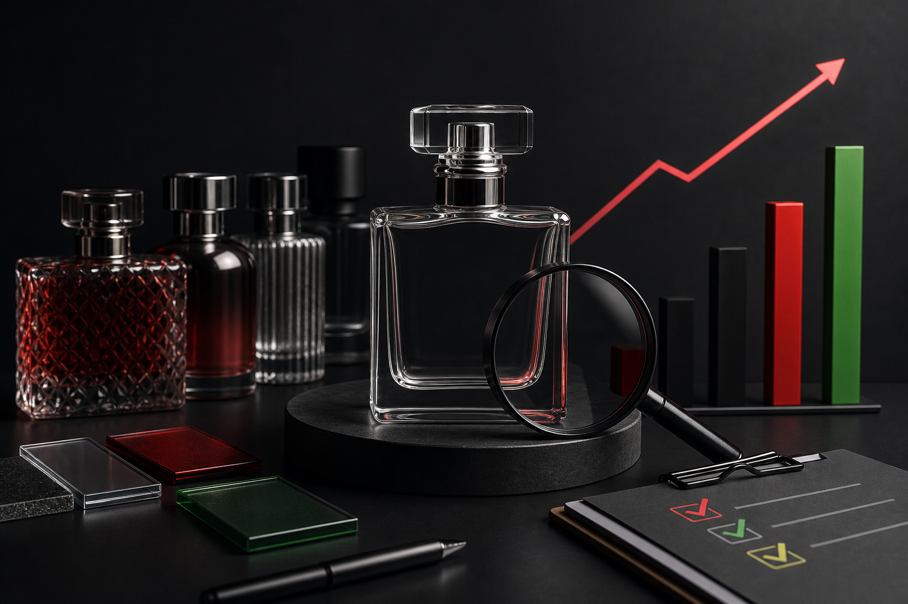

Sourcing perfume glass bottles wholesale looks straightforward until you're deep in supplier conversations and realize you've been comparing quotes that aren't measuring the same things. Wall thickness, glass clarity, neck finish tolerances, decoration options, packaging configuration — every variable shifts the real cost per unit, and none of it shows up in a headline price.

This guide is written for brand managers and procurement leads who are actively evaluating suppliers or preparing an RFQ. It covers how wholesale volume pricing actually works for perfume bottles, which specifications drive cost, and the exact questions you should ask before committing to any supplier relationship.

## How Wholesale Volume Pricing Works for Perfume Bottles

Perfume glass bottles aren't commodity packaging. They carry a premium for aesthetics, precision, and consistency — the bottle is part of the product experience, which means buyers in this category are rarely shopping on unit price alone.

That said, volume still moves the number significantly. Most glass manufacturers structure pricing in tiers based on order quantity. The jump from a small trial order to a mid-volume run typically produces the most meaningful per-unit reduction. Beyond a certain threshold, incremental savings flatten out as production efficiency gains are already captured.

What matters more than hitting a volume tier is understanding what's actually included in the quoted price. Some suppliers quote ex-works, meaning you absorb all freight, insurance, and import duties. Others quote CIF (cost, insurance, and freight) to a named port. These are not equivalent, and comparing them directly will give you a distorted picture of landed cost.

### The Specifications That Actually Drive Per-Unit Cost

**Glass weight** is one of the most direct cost drivers. Heavier bottles use more raw material and require more energy to produce. A thick-walled flacon costs more per unit than a lighter standard bottle, independent of shape complexity.

**Shape complexity** follows closely. Bottles with undercuts, asymmetric profiles, or very narrow necks require more complex molds and slower production runs. If your design calls for a distinctive silhouette, expect that to be reflected in both tooling costs and per-unit pricing.

**Color** adds cost. Clear flint glass is the baseline. Frosted, amber, cobalt, or custom-tinted glass all require additional processing or specialized batch formulations.

**Decoration** is often quoted separately but should be evaluated as part of total unit cost. Screen printing, hot stamping, acid etching, sandblasting, and UV coating each carry different per-unit and setup fees. If you're planning a decorated bottle, ask for an all-in quote that includes the decoration you intend to use at launch — not a base bottle price with decoration treated as an afterthought.

## The Questions You Must Ask Before Placing a Wholesale Order

Good preparation here saves significant time and prevents costly surprises. The questions below are organized by the stage of the supplier conversation where they're most relevant.

### Before Requesting a Quote

**What is your minimum order quantity for standard catalog bottles versus custom designs?**

Standard catalog bottles typically carry lower MOQs because tooling already exists. Custom designs require new mold investment, which is usually amortized across the first production run. Knowing the threshold upfront helps you assess whether a supplier is the right fit for your current order volume.

**Do you offer a handmade or premium glass line?**

For artisan or luxury fragrance brands, a standard machine-made bottle may not match the positioning of the product. Some manufacturers offer handmade glass lines specifically for premium and artisan applications. This is worth asking early, before you've invested time in a catalog review.

**What verticals do you manufacture for?**

A supplier that works exclusively in cosmetics and perfume has different process knowledge than one that also produces pharmaceutical bottles with tight tolerance requirements. Cross-vertical experience often signals a more rigorous QC infrastructure.

### During the RFQ Process

**What is included in your quoted price?**

Ask specifically: Does the price include mold amortization? Decoration? Packaging? Freight to port? A quote that looks competitive may be ex-works with no decoration included, while a higher-looking quote may be all-in landed cost. You need to normalize these before making any comparison.

**What are your glass quality standards and how are they documented?**

Ask for documentation of the supplier's QC system — not just a verbal assurance. Reputable manufacturers maintain formal quality certifications, production equipment certifications, and published quality performance metrics. If a supplier can't produce this documentation, that's worth taking seriously.

**What does your post-processing capability cover?**

Post-processing includes decoration, coating, labeling, and assembly. If you need bottles delivered shelf-ready with caps, pumps, or collars, ask whether the supplier handles this in-house or outsources it. A supplier that covers design, production, post-processing, and finished packaging in a single relationship reduces both coordination overhead and quality risk.

**What is your sampling process and timeline?**

Before committing to a full production run, you should receive physical samples for approval. Ask how many rounds of sampling are standard, what they cost, and how long the process takes from design sign-off to sample delivery.

### Before Signing a Supply Agreement

**What are your payment terms and deposit structure?**

Most glass manufacturers require a deposit before production begins, with the balance due before shipment. Understand the split and whether there's any flexibility based on order history or relationship length.

**How do you handle defects and claims?**

Ask specifically what defect rate is considered acceptable and what the claims process looks like. A supplier with a documented QC system should be able to give you a clear answer. Vague responses here are a risk flag.

**What is your ESG or sustainability documentation?**

If your brand has internal ESG reporting requirements, or if you're selling to retailers that require supplier sustainability disclosures, you need this documentation before onboarding. Ask whether the supplier has a formal ESG program covering environmental, social, and governance dimensions, and whether they can provide supporting materials.

## Why APAC-Origin Supply Matters for Perfume Bottle Sourcing

If your distribution is concentrated in Asia, Southeast Asia, or Oceania, your supplier's manufacturing location affects more than shipping cost. It affects lead time, freight reliability, and your ability to respond quickly to demand changes.

The major global glass manufacturers — O-I Glass, Ardagh Glass Packaging, and Verallia — are primarily built around North American and European production. None of them have meaningful Asia-Pacific manufacturing presence, based on competitive analysis from July 2026. For brands distributing in APAC markets, that translates to longer transit times, more complex logistics, and exposure to trans-Pacific or trans-Indian Ocean freight volatility.

A Taiwan-based manufacturer ships to most major APAC ports on significantly shorter routes. For brands in Southeast Asia, Japan, or Australia, that's a practical operational advantage — not just a geographic preference.

## Custom Perfume Bottles vs. Standard Catalog: Which Is Right for Your Volume?

This is one of the most common sourcing decisions, and the answer depends on where you are in your brand lifecycle.

Standard catalog bottles make sense when you're launching a new fragrance line, testing a new market, or working within a tight budget. Tooling costs are zero, sampling is faster, and MOQs are lower. The trade-off is that your bottle isn't exclusive to your brand.

Custom designs are worth the investment when your brand identity requires a distinctive container, when you're at a volume level where tooling amortization is manageable, or when packaging differentiation is a meaningful competitive factor in your target market. Custom doesn't necessarily mean expensive per unit at scale, but the upfront investment in mold development and sampling needs to be planned for.

Some suppliers offer a middle path: modifications to standard catalog shapes — custom neck finishes, proprietary closures, or exclusive decoration treatments applied to a standard body. This can deliver meaningful visual differentiation without full custom tooling costs.

## Evaluating a Perfume Glass Bottle Supplier: A Practical Checklist

Before finalizing a supplier, work through this list:

- Documented QC system and quality certifications available on request
- Formal sampling process with defined timelines
- Post-processing capability confirmed in writing, not assumed
- ESG documentation available if required for internal reporting
- Clear payment terms and claims process in the supply agreement
- APAC manufacturing or proven APAC shipping routes if your distribution is Asia-focused
- Experience across multiple verticals, indicating process discipline beyond cosmetics alone
- End-to-end service from design through finished packaging, if you need it

## Frequently Asked Questions

**What is the difference between wholesale perfume glass bottles and custom perfume bottles?**

Wholesale perfume glass bottles typically refers to purchasing standard catalog shapes in volume from a manufacturer or distributor. Custom perfume bottles involve commissioning a unique design, which requires mold development and a higher upfront investment but gives your brand an exclusive container. Many manufacturers offer both, and some offer a middle path through modified standard shapes.

**What drives the per-unit cost of perfume glass bottles at wholesale?**

The main cost drivers are glass weight, shape complexity, glass color or treatment, and decoration. Heavier glass, asymmetric or complex shapes, specialty colors, and surface decoration such as screen printing or acid etching all add to per-unit cost. Volume tier also affects pricing, with meaningful reductions typically occurring as order quantities increase.

**Should I compare wholesale quotes on a per-unit basis?**

Not directly, without normalizing for what's included. One quote may be ex-works with no decoration; another may include decoration, packaging, and freight to port. Always ask what is and isn't included before comparing quotes, and calculate landed cost rather than factory gate price.

**How do I evaluate a supplier's quality before placing a large order?**

Request physical samples before committing to a full run. Ask for documentation of the supplier's QC system, certifications, and quality performance metrics. A credible manufacturer will have these on file and be willing to share them. Also ask specifically about their defect rate standards and claims process.

**What should I ask about ESG when sourcing perfume glass bottles?**

Ask whether the supplier has a formal ESG program covering environmental protection, social responsibility, and corporate governance. If your brand has internal ESG reporting requirements, or if your retail partners require supplier sustainability disclosures, you need this documentation before onboarding. Request supporting materials, not just a verbal confirmation.

**Why does the supplier's manufacturing location matter for perfume bottle sourcing?**

Manufacturing location affects shipping lead time, freight cost, and supply chain resilience. If your distribution is concentrated in Asia or Oceania, a Taiwan or APAC-based manufacturer will typically offer shorter transit times and simpler logistics than a European or North American supplier. The major global glass manufacturers have limited Asia-Pacific manufacturing presence, which is a practical consideration for APAC-focused brands.

**Is a handmade glass line worth considering for a luxury fragrance brand?**

For premium or artisan fragrance positioning, a handmade glass line can provide visual and tactile qualities that machine-made bottles can't replicate. The trade-off is higher per-unit cost and lower production volume. If your brand sits at the luxury end of the market and packaging is a core part of the product story, it's worth asking whether your supplier offers a handmade option alongside their standard catalog.

## Get Sourcing Right From the Start

Wholesale perfume glass bottle sourcing rewards preparation. Suppliers who receive a well-structured RFQ — with clear specifications, realistic volume expectations, and specific questions about QC and post-processing — take those inquiries seriously. The questions in this guide are the ones that separate buyers who get accurate quotes from those who spend weeks chasing clarifications.
